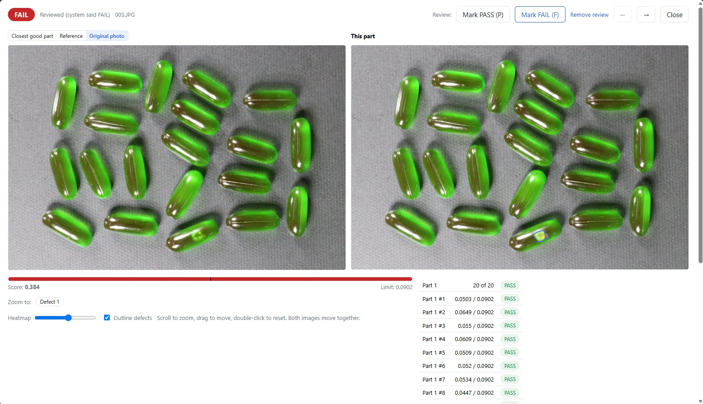

You want to automate visual inspection for a small batch, but you have no collection of documented defect images. What do you actually need to get an inspection station started? This capsule example shows an approach based on good images: after training on 16 good images, VisionInspect flagged three defective test images as FAIL and accepted one good image as PASS.

## A small test with a clear result

The images are the VisionInspect owner's own photos. They show green capsules, with a visibly damaged capsule in the defect example. VisionInspect classified that image as **FAIL, with a score of 0.384 against a limit of 0.0902**.

The software set the limit automatically using good images only. Training used 16 good images, followed by a test with one good image and three defective images.

| Test item | Result in this example |
| --- | --- |
| Good images used for training | 16 |
| Basis for the automatic limit | Good images only |
| Test set | 1 good image, 3 defective images |
| Defective images caught | 3 |
| Defective images missed | 0 |
| Good images rejected | 0 |
| Defect result shown | FAIL, score 0.384 against a limit of 0.0902 |
| Training time | About 15 minutes on a laptop GPU with 4 GB of GPU memory |

This demonstrates the result on four test images; **it does not establish a detection rate or prove readiness for production**. The next step for your inspection station is a test with your own parts and the defects that matter to your process.

## What the defect image shows

The result screen displays the capsule images side by side and shows the FAIL decision. The score for this defective image sits above the set limit, turning the image assessment into a clear pass/fail result.

VisionInspect provides a heat map, a score and a PASS or FAIL decision against one limit for each part. Operators can review the highlighted image region as well as the number, then compare the result with the part itself.

## Why starting with good images suits small batches

If you have not collected defective parts yet, you do not need them to build the training set. VisionInspect learns from good parts only. Defective samples are optional; starting from five examples, they can be used to check and fine-tune the pass/fail limit.

You can start with three good samples, with 10–30 recommended. The 16 good images used here fall within that recommendation. Photos are aligned to the reference automatically.

For preparation, begin with parts you have approved as acceptable. Define which visible differences are allowed and which should lead to rejection. Those acceptance criteria belong to your inspection task, rather than being a decision left entirely to the software.

The [visual inspection without defect images](/visual-inspection-without-defect-images/) solution page explains the overall process. This capsule example shows a specific result using a limit set automatically from good images.

## Separate training time from production inspection

Training took about 15 minutes on a laptop GPU with 4 GB of GPU memory. That time covers learning from the good images. Plan the training stage separately from inspection at your production cycle time.

In your own trial, first check whether the decisions match your acceptance criteria. Review good and defective images alongside their scores and highlighted regions. Decide in advance who will assess the results and which defects require a FAIL decision.

## From a trial to an inspection station

VisionInspect runs locally and offline on your PC or server. Nothing leaves the plant unless you enable the optional AI second opinion. That feature writes a short comment on failed parts as advice only; it does not change the verdict.

Integration options include Modbus TCP for a PLC, webhook, MQTT and GPIO, plus CSV and ZIP exports. For the trial, decide whether an operator will review results on screen or whether sending the result to the machine controller is part of the task.

Start with a clearly defined scope: one part family, approved good images and explicitly named rejection criteria. The useful question is not whether AI is interesting, but whether the inspection decisions match the standards you use to release parts.

Send photos of your good parts for a demo, or start a **one-week trial with your own parts**. Keep any available defective parts for checking results, and compare the PASS/FAIL decisions with your current visual inspection.
