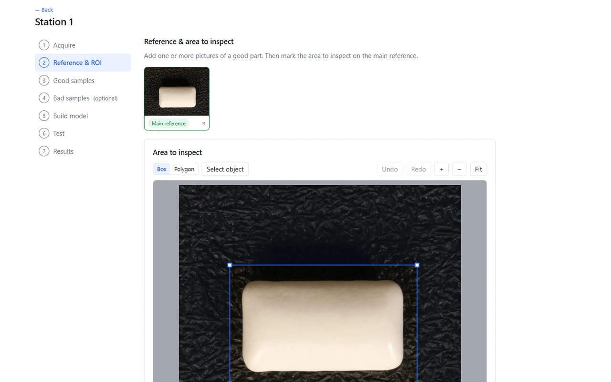
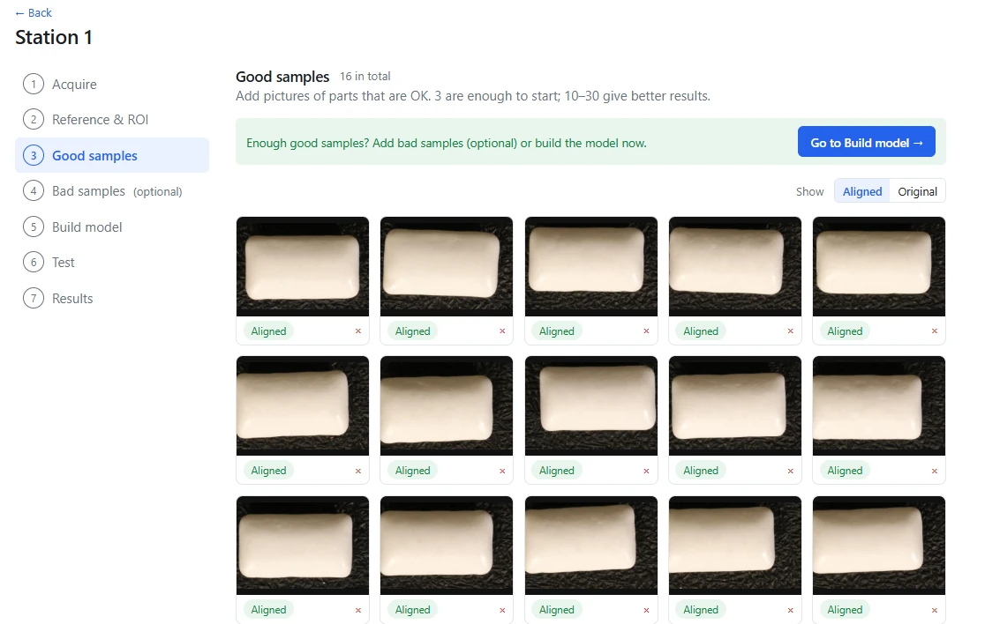
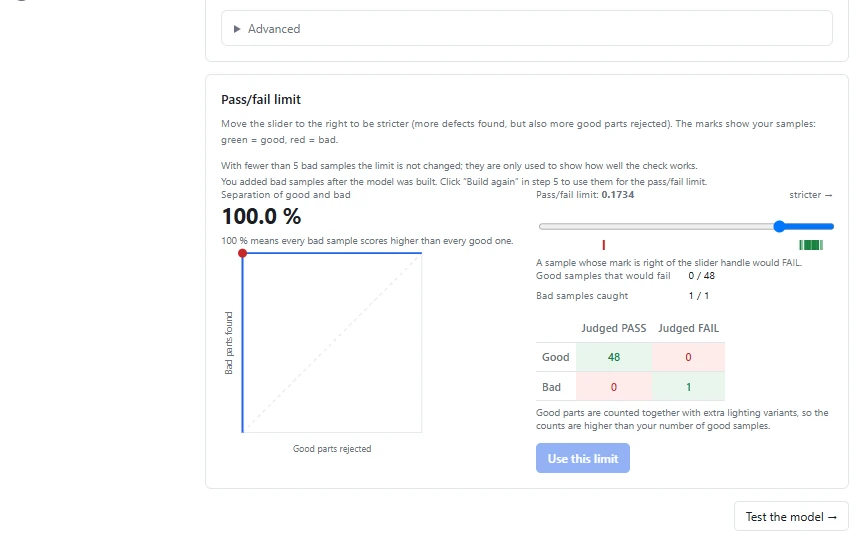
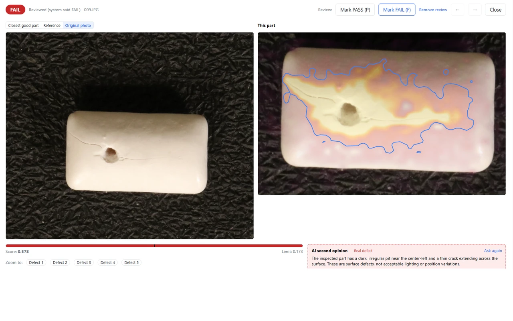

Viele KI-Prüfprojekte kommen nicht in Gang, weil zuerst Hunderte Bilder jeder Fehlerart gesammelt werden müssten. Die Anomalieerkennung dreht das um: Das Modell lernt, wie ein **gutes** Teil aussieht, und alles, was abweicht, fällt auf.

Dieser Artikel zeigt eine komplette Einrichtung in VisionInspect, mit den echten Bildschirmen und den echten Zahlen. Die Teile sind Kaugummis aus dem öffentlichen [VisA-Datensatz](https://github.com/amazon-science/spot-diff) (CC BY 4.0), ein guter Ersatz für kleine Form- oder Pressteile mit leicht unregelmäßiger Oberfläche.

## Schritt 1: Referenz und Prüfbereich

Am Anfang steht ein Bild eines Gutteils. Darauf markieren Sie den Prüfbereich, hier ein einfaches Rechteck um das Teil. Alles außerhalb, etwa der strukturierte Hintergrund, wird ignoriert.

## Schritt 2: Gutteile

Danach folgen Fotos von Gutteilen. Die Software verlangt mindestens 3 und empfiehlt 10 bis 30. Wir haben **16** verwendet. Jedes Foto wird automatisch an der Referenz ausgerichtet, die Teile müssen also nicht exakt an derselben Stelle liegen. Man sieht, dass sie leicht verschoben und verdreht sind.

Schlechtteile sind optional. Wir haben einige hinzugefügt, nur um das Ergebnis zu prüfen. Zum Anlernen werden sie nicht gebraucht.

## Schritt 3: Modell erstellen und Grenze setzen

Das Modell entsteht mit einem Klick. VisionInspect schlägt danach selbst eine Gut/Schlecht-Grenze vor. Für diese Station:

| Wert | Ergebnis |
|---|---|
| Gutteile | 16 (plus Beleuchtungsvarianten, insgesamt 48 Prüfungen) |
| Gut/Schlecht-Grenze | 0,173, automatisch gesetzt |
| Gutteile, die durchfallen würden | 0 von 48 |
| Erkannte Schlechtteile | 1 von 1 |

Ehrlich gesagt: Ein einziges Schlechtteil sagt wenig über eine Erkennungsrate aus. Es zeigt, dass die Prüfung funktioniert, nicht wie gut sie über Hunderte Fehler hinweg ist. An einer echten Linie fügen Sie weitere Schlechtteile hinzu, sobald sie auftreten. Ab fünf nutzt VisionInspect sie auch, um die Grenze nachzujustieren.

## Schritt 4: Prüfen

Nun kommt ein neues Teil, das das Modell noch nie gesehen hat. Es hat einen Ausbruch und einen feinen Riss quer über die Oberfläche.

Der Score liegt bei **0,578**, mehr als das Dreifache der Grenze von 0,173, also ein klares **n.i.O.** Die Heatmap zeigt, wo das Teil von den Gutteilen abweicht, und die Umrandung markiert den Fehlerbereich. Die optionale KI-Zweitmeinung ergänzt eine kurze schriftliche Einschätzung: ein dunkler, unregelmäßiger Ausbruch und ein feiner Riss, also Oberflächenfehler und keine zulässigen Licht- oder Lageabweichungen. Sie ist nur ein Hinweis, das Ergebnis bestimmen Modell und Grenze.

## Was das zeigt

- **Keine Fehlerbibliothek.** Das Modell wurde nur aus Gutteilen erstellt.
- **Eine Zahl entscheidet.** Die Gut/Schlecht-Grenze ist die einzige Einstellung, und die Software schlägt sie vor.
- **Nachvollziehbare Ergebnisse.** Zu jedem n.i.O. gibt es eine Heatmap, so sieht der Werker in Sekunden, warum.

Was es nicht zeigt, ist eine Erkennungsrate in der Serie. Dafür braucht es Ihre Teile, Ihre Kamera und Ihre Beleuchtung. Deshalb bieten wir einen einwöchigen Test an Ihren eigenen Teilen an.
