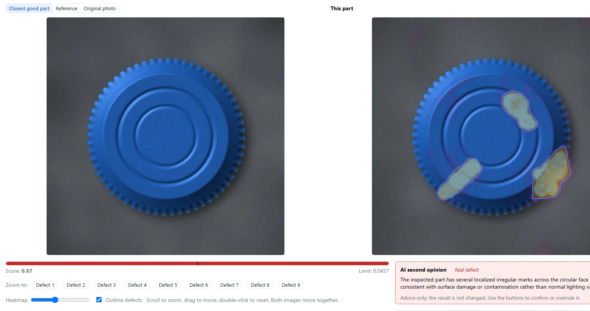
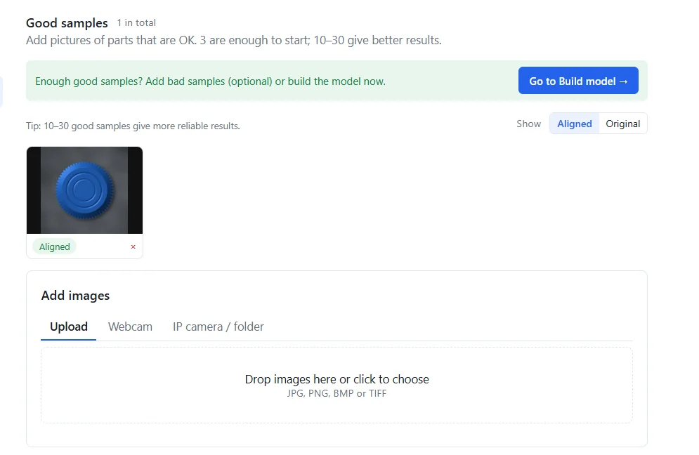

Sie brauchen am Prüfplatz eine klare Entscheidung: Ist das Teil i.O. oder n.i.O.? Eine farbige Markierung allein reicht dafür nicht. Dieser reale VisionInspect-Test zeigt, wie Heatmap, Score und Prüfgrenze zusammengehören: Das gezeigte Schlechtteil erhielt den Score **0,67** und lag damit über der automatisch gesetzten Grenze von **0,0457**.

## Das Ergebnis: ein Schlechtteil erkannt, ein Gutteil akzeptiert

Für diesen Versuch wurde das Modell mit einem einzigen Gutbild trainiert. Anschließend wurden ein Gutbild und ein Schlechtbild geprüft. Das Schlechtteil wurde erkannt, das Gutteil nicht zurückgewiesen; kein Fehlerteil wurde in diesem Test übersehen.

Die Prüfgrenze entstand automatisch aus dem Gutmaterial. Schlechtbilder waren dafür nicht nötig. Das Training dauerte etwa eine Minute auf einer Laptop-GPU mit 4 GB Grafikspeicher.

| Punkt | Ergebnis dieses Versuchs |
|---|---|
| Training | 1 Gutbild |
| Festlegung der Prüfgrenze | Automatisch, nur aus Gutmaterial |
| Geprüfte Bilder | 1 Gutbild und 1 Schlechtbild |
| Erkannte Schlechtteile | 1 |
| Übersehene Schlechtteile | 0 |
| Zurückgewiesene Gutteile | 0 |
| Score des gezeigten Schlechtteils | 0,67 |
| Prüfgrenze | 0,0457 |
| Urteil für das Schlechtteil | FAIL / n.i.O. |

Das Beispiel zeigt, dass ein Gutbild für diesen konkreten Versuch ausgereicht hat. **Es belegt keine Erkennungsrate oder Serientauglichkeit für andere Teile und Fehler.**

## Was bedeutet Anomalieerkennung hier?

VisionInspect lernt aus Gutteilen. Statt zunächst eine Sammlung bekannter Fehler anzulegen, geben Sie dem System Bilder des akzeptierten Zustands. Bei der Prüfung erhält jedes Teil eine Heatmap, einen Score und ein PASS/FAIL-Urteil gegen eine gemeinsame Prüfgrenze.

Im gezeigten Versuch gehörte das Schlechtbild nicht zum Training. Es diente zur anschließenden Prüfung des Modells. Damit bleiben zwei Aufgaben getrennt: Das Gutmaterial bildet die Lernbasis; ein Schlechtteil prüft, ob die gewünschte Abweichung tatsächlich zur Zurückweisung führt.

Für die Qualitätssicherung ist diese Trennung wichtig. Ein erfolgreiches Training und eine erfolgreich erkannte Abweichung sind unterschiedliche Ergebnisse. Hier liegen beide vor: Das Modell wurde aufgebaut, und das anschließend geprüfte Schlechtteil erhielt FAIL.

## Heatmap, Score und Urteil beantworten verschiedene Fragen

Die **Heatmap** zeigt, welche Bildbereiche das System als auffällig markiert. Im Ergebnisbild sehen Sie das Prüfteil neben der Referenz und die hervorgehobenen Bereiche. Damit können Sie die Markierungen mit dem sichtbaren Zustand des Teils vergleichen.

Der **Score** ist der Zahlenwert für den Vergleich mit der Prüfgrenze. Beim gezeigten Schlechtteil beträgt er 0,67. Für das Verständnis dieses Ergebnisses ist entscheidend, dass der Wert über 0,0457 liegt.

Das **Urteil** übersetzt diesen Vergleich in PASS oder FAIL, also i.O. oder n.i.O. In diesem Fall lautet es FAIL. Die drei Ausgaben ergänzen sich somit: Wo liegt die Auffälligkeit, welchen Score erhält das Teil, und auf welcher Seite der Grenze liegt es?

Eine optionale KI-Zweitmeinung kann zusätzlich einen kurzen Kommentar zu fehlgeschlagenen Prüfungen schreiben. Dieser Kommentar ist nur ein Hinweis und verändert das Urteil nicht. Für die Entscheidung bleibt der Vergleich mit der Prüfgrenze maßgeblich.

## Die Prüfgrenze gehört zur Einrichtung des Prüfplatzes

VisionInspect schlägt die Prüfgrenze vor. In diesem Versuch wurde sie ausschließlich aus dem Gutmaterial automatisch gesetzt. Das danach getestete Gutbild wurde akzeptiert, während das Schlechtbild die Grenze überschritt.

Für Ihren eigenen Prüfplatz sollten Sie den Vorschlag mit Ihren Teilen prüfen: Werden die vorgesehenen Gutteile akzeptiert, und führen die relevanten Abweichungen zu n.i.O.? Schlechtteile sind für das Lernen nicht erforderlich. Ab fünf Schlechtbildern können sie optional zur Überprüfung und Feinabstimmung der Gut/Schlecht-Grenze eingesetzt werden.

Beurteilen Sie deshalb nicht nur, ob eine Heatmap sichtbar wird. Prüfen Sie auch das daraus entstehende Urteil. Genau diese Unterscheidung macht das Beispiel greifbar: Die Auffälligkeit wurde nicht bloß markiert, sondern das Teil bei der eingestellten Grenze zurückgewiesen.

## Ein Gutbild im Versuch, mehr Gutmaterial für Ihren Einstieg

Der Versuch wurde mit einem Gutbild durchgeführt. Für den regulären Einstieg sieht VisionInspect drei Gutbilder vor; empfohlen sind zehn bis dreißig. Die Fotos werden automatisch an der Referenz ausgerichtet.

Nutzen Sie das Ergebnis als konkreten Ausgangspunkt für einen eigenen Test, nicht als Vorgabe, Ihren Prüfbestand auf ein Bild zu beschränken. Halten Sie dabei Training, Prüfung und Grenzentscheidung auseinander. So lässt sich nachvollziehen, womit das Modell gelernt hat und welche Teile es anschließend akzeptiert oder zurückgewiesen hat.

Mehr zum Verfahren finden Sie bei der [KI-Sichtprüfung ohne Fehlerbilder](/de/sichtpruefung-ohne-fehlerbilder/).

Senden Sie Fotos Ihrer Gutteile für eine Demo oder starten Sie einen **einwöchigen Test mit Ihren eigenen Teilen**. Prüfen Sie dabei gemeinsam Score, Markierungen und i.O./n.i.O.-Entscheidung.
