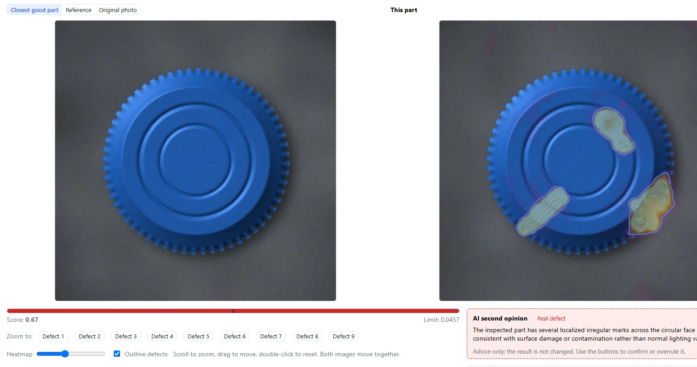
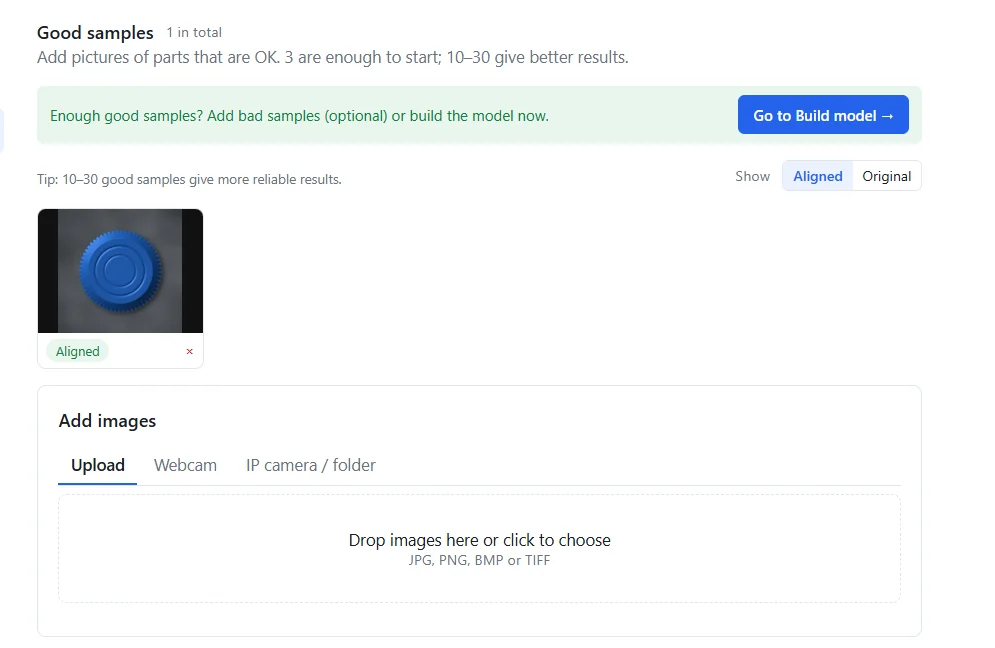

At an inspection station, you need a clear answer: does this part pass or fail? A coloured highlight alone is not enough. This real VisionInspect test shows how the heat map, score and pass/fail limit work together: the defective part scored **0.67**, above the automatically set limit of **0.0457**.

## The result: one defective part caught, one good part accepted

For this test, the model trained on a single image of a good part. It then inspected one good image and one defective image. The defective part was caught, the good part was accepted, and no defective part was missed in this test.

The pass/fail limit was set automatically using only the good sample. No defect images were needed to set it. Training took about one minute on a laptop GPU with 4 GB of GPU memory.

| Item | Result in this test |
|---|---|
| Training | 1 good image |
| Limit setting | Automatic, using only the good sample |
| Images tested | 1 good image and 1 defective image |
| Defective parts caught | 1 |
| Defective parts missed | 0 |
| Good parts rejected | 0 |
| Score of the defective part shown | 0.67 |
| Pass/fail limit | 0.0457 |
| Verdict for the defective part | FAIL |

This example shows that one good image was enough for this particular test. **It does not establish a detection rate or prove production readiness for other parts and defects.**

## What does anomaly detection mean here?

VisionInspect learns from good parts. Instead of first collecting examples of known defects, you give the system images of an acceptable part. During inspection, each part receives a heat map, a score and a PASS/FAIL verdict against one limit.

In this test, the defective image was not part of the training set. It was used afterwards to check the model. That keeps two jobs separate: good samples provide the basis for learning; a defective sample checks whether the deviation you want to catch actually causes a rejection.

This distinction matters in quality control. Completing training and detecting a defect are different results. Both happened here: the model was trained, and the defective part inspected afterwards received a FAIL verdict.

## The heat map, score and verdict answer different questions

The **heat map** shows which areas of the image the system flags as unusual. The results screen displays the test part beside the reference, with the flagged areas highlighted. You can compare those markings with the visible condition of the part.

The **score** is the numerical value compared with the pass/fail limit. The defective part shown scored 0.67. The key to understanding this result is that its score exceeded the limit of 0.0457.

The **verdict** turns that comparison into PASS or FAIL. Here, the verdict was FAIL. Together, the three outputs answer three practical questions: where is the unusual area, what score did the part receive, and which side of the limit did it fall on?

An optional AI second opinion can also write a short comment on failed parts. That comment is advice only and does not change the verdict. The score's comparison with the limit remains the basis for the decision.

## Setting the limit is part of inspection setup

VisionInspect proposes the pass/fail limit. In this test, it was set automatically from the good sample alone. The good image tested afterwards was accepted, while the defective image scored above the limit.

At your own inspection station, check that proposal against your parts: do acceptable parts pass, and do the relevant defects cause a FAIL? Defective samples are not required for learning. From five defective samples onwards, they can optionally be used to check and fine-tune the pass/fail limit.

Do not assess the result only by whether a heat map appears. Check the resulting verdict too. This example makes the distinction clear: the unusual area was not just highlighted; the part was rejected at the configured limit.

## One good image in this test, more for your own setup

This test used one good image for training. For a regular setup, VisionInspect starts with three good samples; ten to thirty are recommended. Photos are automatically aligned to the reference.

Use this result as a starting point for your own test, not as a reason to restrict your training set to one image. Keep training, testing and the limit decision separate. That makes it easier to track what the model learned from and which parts it subsequently accepted or rejected.

Learn more about [visual inspection without defect images](/visual-inspection-without-defect-images/).

Send photos of your good parts for a demo, or start a **one-week trial with your own parts**. Check the scores, highlighted areas and PASS/FAIL decisions together.
