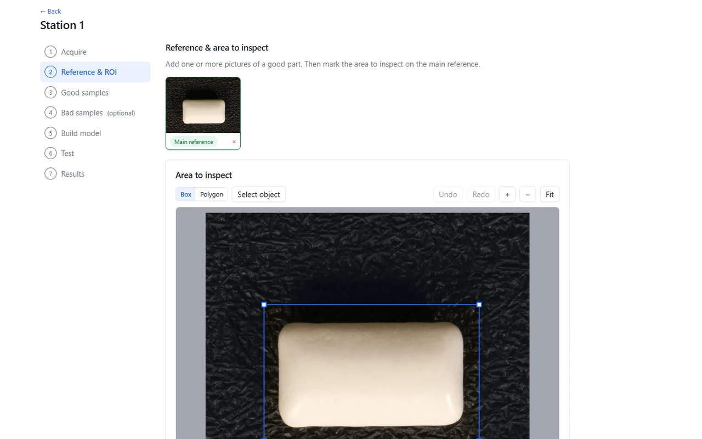
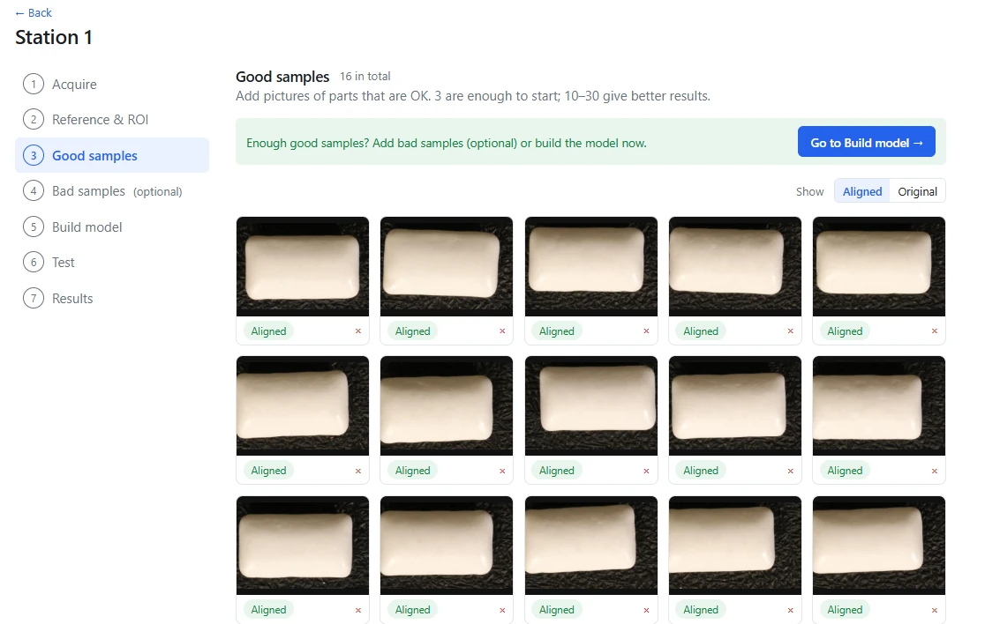
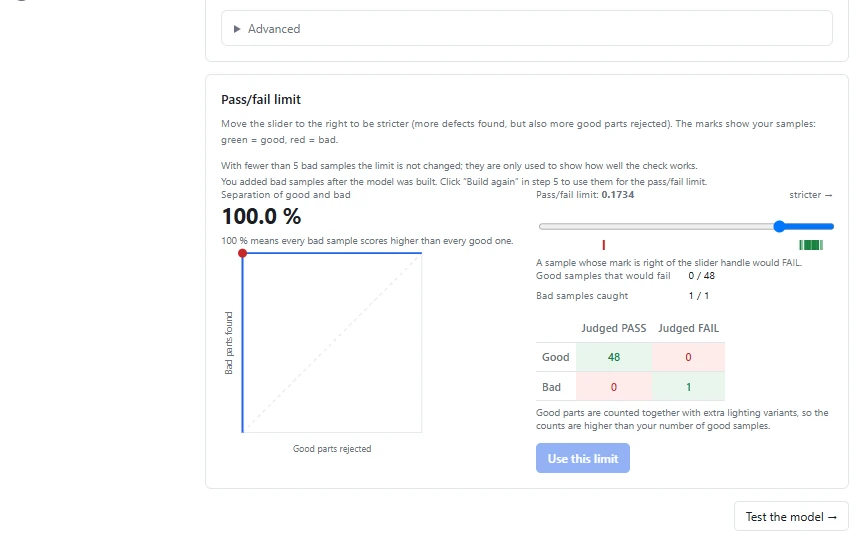
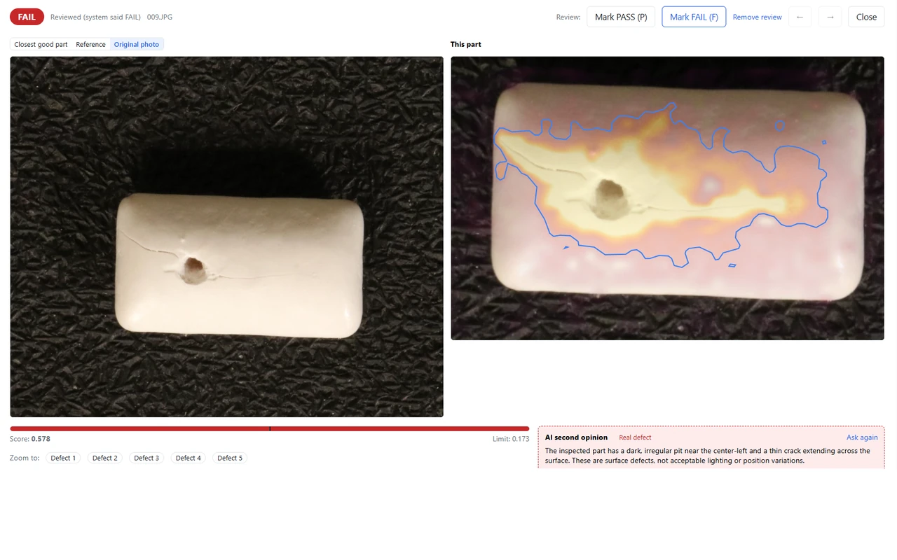

Most AI inspection projects stall before they start, because someone has to collect hundreds of images of every defect. Anomaly detection turns that around: the model learns what a **good** part looks like, and anything that differs stands out.

This article walks through one complete setup in VisionInspect, with the real screens and the real numbers. The parts are pieces of chewing gum from the public [VisA dataset](https://github.com/amazon-science/spot-diff) (CC BY 4.0), a good stand-in for small moulded or pressed parts with a slightly uneven surface.

## Step 1: Reference and area to inspect

Everything starts with one picture of a good part. On it, you mark the area to inspect: here a simple box around the piece. Everything outside the box, such as the textured background, is ignored.

## Step 2: Good samples

Next come photos of good parts. The app asks for at least 3 and suggests 10 to 30. We used **16**. Every photo is aligned to the reference automatically, so the parts do not have to sit in exactly the same position. You can see the pieces are slightly shifted and rotated.

Bad samples are optional. We added a couple, only to check the result. They are not needed to train the model.

## Step 3: Build the model and set the limit

Building the model is one click. VisionInspect then proposes a pass/fail limit on its own. For this station:

| Value | Result |
|---|---|
| Good samples | 16 (plus lighting variants, 48 checks in total) |
| Pass/fail limit | 0.173, set automatically |
| Good samples that would fail | 0 of 48 |
| Bad samples caught | 1 of 1 |

A word of honesty about that table: one bad sample says little about a detection rate. It shows that the check works, not how well it works across hundreds of defects. On a real line, you would add more bad parts as they turn up. With five or more, VisionInspect also uses them to fine-tune the limit.

## Step 4: Inspect

Now a new piece comes in, one the model has never seen. It has a pit and a thin crack running across the surface.

The score is **0.578**, more than three times the limit of 0.173, so the verdict is a clear **FAIL**. The heat map shows where the piece differs from the good ones, and the outline marks the defect area. The optional AI second opinion adds a short written note: a dark, irregular pit and a thin crack, “surface defects, not acceptable lighting or position variations”. It is advice only, and the verdict stays with the model and your limit.

## What this shows

- **No defect library.** The model was built from good parts only.
- **One number to decide.** The pass/fail limit is the only setting, and the app proposes it.
- **Explainable results.** Every FAIL comes with a heat map, so an operator can see why within seconds.

What it does not show is a production detection rate. That needs your parts, your camera and your lighting, which is why we offer a one-week trial on your own parts.
