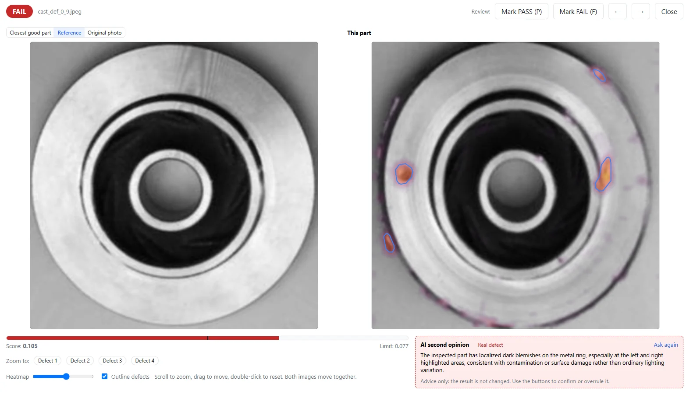
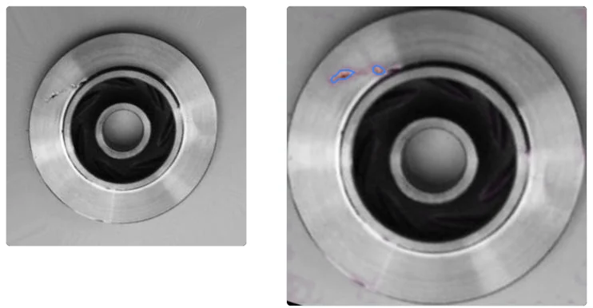

A casting fails inspection, and the operator’s next question is simple: where should I look? A red FAIL label gives a decision, but not a location. This casting example shows how VisionInspect presents the reference, highlighted areas, score and pass/fail limit together—and how to read them without treating the heat map as a complete defect diagnosis.

## The result: seven defective samples caught

VisionInspect learned from **56 good samples**. The pass/fail limit was set automatically from good samples only, rather than adjusted using defective examples. Training took about **15 minutes on a laptop GPU with 4 GB of GPU memory**.

The subsequent test contained seven good samples and seven defective samples. All seven defective samples were caught, none were missed, and none of the seven good samples were rejected.

| Item | Result |
|---|---|
| Good samples used for training | 56 |
| Limit selection | Automatic, from good samples only |
| Good samples tested | 7 |
| Defective samples tested | 7 |
| Defective samples caught / missed | 7 / 0 |
| Good samples rejected | 0 |
| Shown defective sample | FAIL: score 0.105 against limit 0.077 |

This test shows that the chosen limit separated these tested good and defective samples; it does not establish a production detection rate or false-reject rate.

The images here are VisionInspect results prepared by the owner using their own photos.

## Read the decision and location together

The result screen places the good reference beside the inspected casting. On the inspected part, coloured highlights draw attention to areas on the casting’s outer face and edge. For the shown result, the score is **0.105**, above the **0.077** limit, so the verdict is **FAIL**.

These outputs serve different purposes. The score and limit explain the decision numerically; the heat map gives the operator a place to start looking. Use them together rather than asking the colours alone to explain why a part failed.

In practice, start with the verdict, compare the score with the limit, then examine the highlighted locations against the reference and the part itself. That keeps the inspection decision separate from the operator’s assessment of the physical defect.

## A highlight is a prompt to inspect, not a defect name

The heat map is useful for directing attention, but a highlighted patch is not itself a label such as “crack,” “scratch” or “dent.” In this example, the confirmed result is a defective casting. The operator should check the marked areas before assigning a more specific defect description.

The photographs and the result screen support different parts of that review. The photographs let the reader examine the casting’s appearance, while the result screen adds the reference comparison, highlights and decision. At a review station, use the image to locate the area, then check it against your acceptance criteria.

VisionInspect also offers an optional AI second opinion that writes a short comment on failed parts. Treat that comment as advice: it does not change the verdict. Keep the score-and-limit decision distinct from any suggested explanation.

## What the good samples contributed

VisionInspect learns from good parts only and automatically aligns photos to the reference. Each inspected part then receives a heat map, a score and PASS/FAIL against one limit proposed by the app. For this casting test, both learning and automatic limit selection used the good samples.

The 56 training samples describe this run, not a minimum requirement for every casting application. The product starts with three good samples, with 10–30 recommended. Defective samples are optional and, from five bad samples onward, can be used to check and fine-tune the pass/fail limit.

For your own trial, keep the roles clear: good samples teach the model, while a separate set of good and defective parts checks the resulting decisions. Review the highlighted locations as well as the verdicts. A useful review asks both “Did it reject the right part?” and “Where did it direct the operator’s attention?”

## Bring the same questions to your inspection station

Before a trial, decide how an operator will handle a failed casting. Who reviews the marked area, which acceptance criteria apply, and how will the review outcome be recorded? Those questions turn an inspection screen into a practical work instruction.

VisionInspect runs locally and offline on your PC or server; nothing leaves the plant unless the optional AI check is turned on. The [visual inspection without defect images solution](/visual-inspection-without-defect-images/) describes the approach used here.

Send photos of your good castings to arrange a demo or a **1-week trial on your own parts**. Include known defective examples if available, so you can check the verdicts and heat maps against parts your team already understands.
