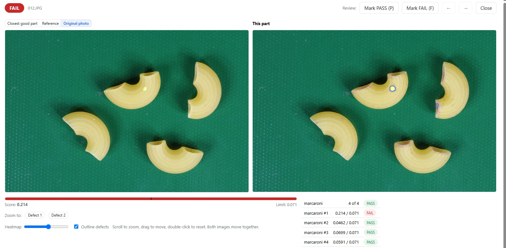
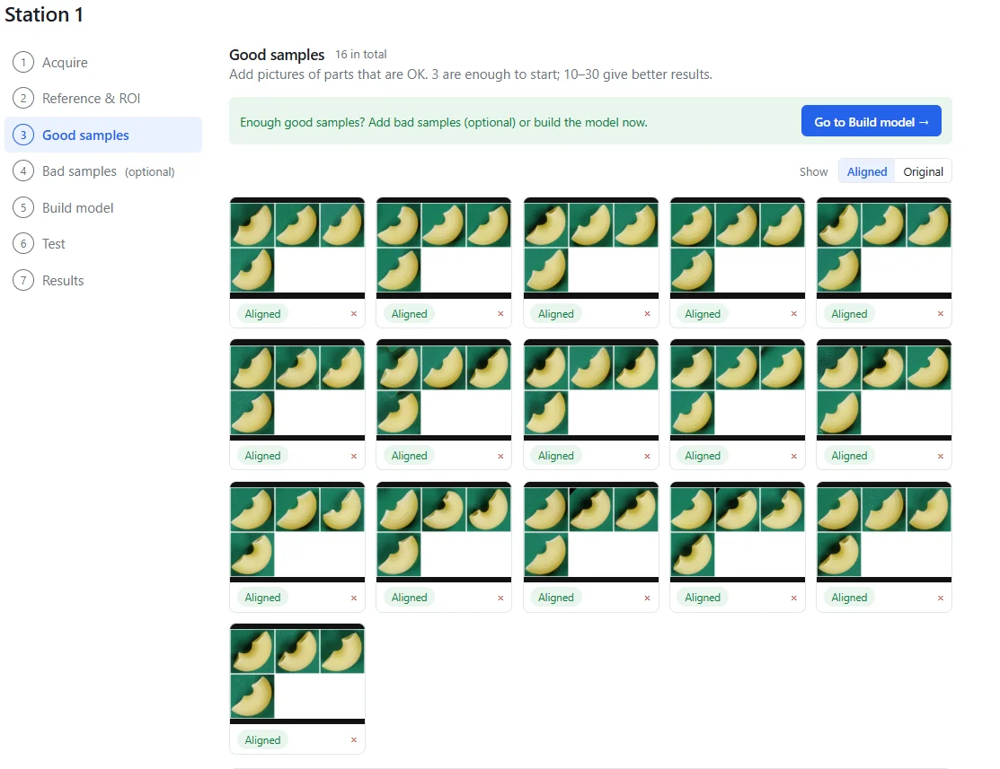

You want to check several parts in the same camera view, rather than present each one separately. But what does a failed image actually tell the operator, and how should you count the test results? This macaroni example shows a multi-part view inspected by VisionInspect after training on 16 good images, with all three defective test images flagged.

## The result: several pieces, one inspected view

The images contain several macaroni pieces on a green background. In the featured result, VisionInspect reports **FAIL**, with a score of **0.214** against an automatically set limit of **0.071**. The result screen places the reference beside the inspected view and marks the anomalous area.

These are VisionInspect results prepared by the owner, using images from [the public VisA dataset (CC BY 4.0)](https://github.com/amazon-science/spot-diff). The subject here is macaroni, not a production-line board or assembly.

The useful point is that the camera view did not contain only an isolated piece. A defect was flagged in a scene containing several pieces. For someone evaluating a grouped inspection, that is a concrete result to examine rather than a general promise about AI.

## What was trained and what was tested

VisionInspect learned from 16 good images. The pass/fail limit was set automatically from those good samples only; defective images were used for the test, not to teach the model what a defect looked like.

| Item | Result |
| a | b |
| Good training images | 16 |
| Good test images | 2 |
| Defective test images | 3 |
| Defective images caught | 3 |
| Defective images missed | 0 |
| Good test images rejected | 0 |
| Featured failed image | Score 0.214; limit 0.071 |
| Training | About 20 minutes on a laptop GPU with 4GB GPU memory |

This small test shows that the model separated these good and defective images; it does not establish a production detection rate or performance across other arrangements, defects or camera conditions.

## Count images separately from individual parts

The test totals refer to **images**, not to individually counted macaroni pieces. “Three defective images caught” is the result to carry forward. It is not a claim that each visible piece received its own independently validated verdict.

That distinction matters when you define the inspection task. Ask whether your process needs a decision on the whole presented group, or whether the operator must identify and remove a particular piece. Write that requirement into the trial before judging the result screen.

For a grouped view, review both the verdict and the marked area. In this example, the failed image gives the operator a place to look alongside the numerical result. In your trial, check whether that information is sufficient for the action you expect the operator to take.

## Preparing the inspection view

The setup pictures show the inspection-area selection and the good-image training view. VisionInspect aligns photos to the reference automatically, and the training screen shows the aligned samples.

Use this preparation stage to review what you intend to inspect. Decide which pieces belong in the view, what counts as an acceptable presentation, and which area the inspection should cover. Then select good images that match that intended task.

VisionInspect starts with 3 good samples, with 10–30 recommended. This example used 16 good images. Treat that as the training set for this result, rather than a minimum established for every multi-part scene.

## Make your own trial answer the production question

For a useful evaluation, keep the training images and the test images separate, as they were here. Include acceptable grouped views as well as views containing known defects, and record the outcome for each test image.

Define the counting unit clearly: an image, a group or an individual part. If your requirement is individual-part rejection, check that requirement explicitly rather than treating a failed group image as sufficient evidence.

VisionInspect provides a heat map, a score and a PASS/FAIL verdict against one limit. The [visual inspection without defect images solution](/visual-inspection-without-defect-images/) explains the good-part learning approach behind this workflow. The inspection runs locally and offline on your PC or server; nothing leaves the plant unless you turn on the optional AI check.

Send photos of good parts in the grouped view you want to inspect, plus any known defective examples you have. Use a demo or a 1-week trial on your own parts to check both the image-level result and the operator's next action.
