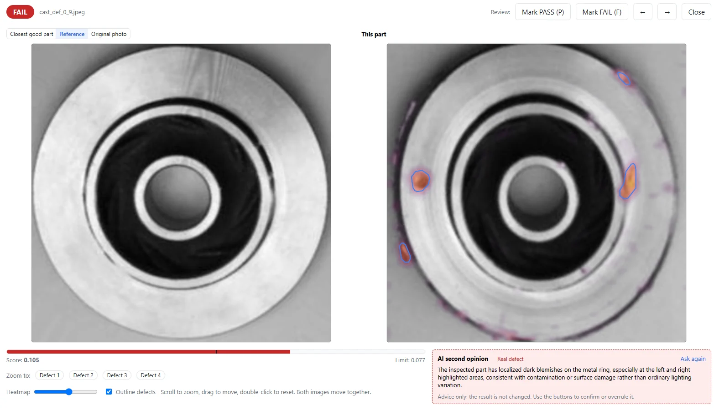
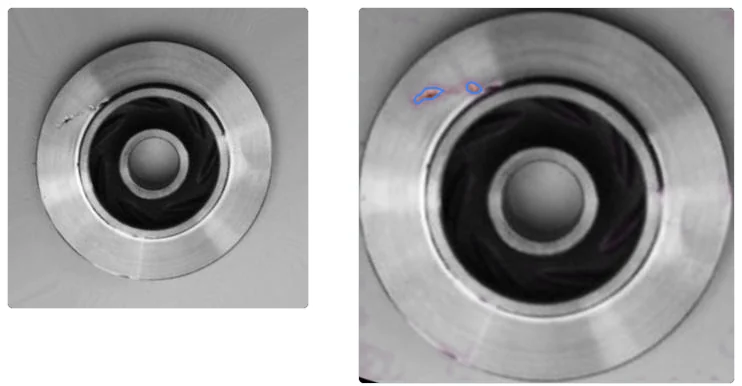

Ein Gussteil wird als n.i.O. eingestuft. Die nächste Frage am Prüfplatz lautet: Wo muss ich genauer hinsehen? Eine rote FAIL-Anzeige liefert eine Entscheidung, zeigt aber noch keine konkrete Stelle. Dieses Beispiel zeigt, wie Sie Referenzbild, Heatmap, Prüfwert und Entscheidungsgrenze gemeinsam lesen – ohne die farbigen Markierungen mit einer vollständigen Fehlerdiagnose zu verwechseln.

## Das Ergebnis: sieben Schlechtteile erkannt

VisionInspect lernte anhand von **56 Gutteilen**. Die Entscheidungsgrenze wurde automatisch und ausschließlich aus Gutteilen bestimmt, nicht mithilfe von Schlechtteilen angepasst. Das Training dauerte etwa **15 Minuten auf einer Laptop-GPU mit 4 GB Grafikspeicher**.

Anschließend wurden sieben Gutteile und sieben Schlechtteile geprüft. Alle sieben Schlechtteile wurden erkannt, keines wurde übersehen. Keines der sieben Gutteile wurde fälschlich abgewiesen.

| Prüfpunkt | Ergebnis |
|---|---|
| Gutteile für das Training | 56 |
| Festlegung der Entscheidungsgrenze | Automatisch, nur anhand von Gutteilen |
| Geprüfte Gutteile | 7 |
| Geprüfte Schlechtteile | 7 |
| Schlechtteile erkannt / übersehen | 7 / 0 |
| Gutteile fälschlich abgewiesen | 0 |
| Gezeigtes Schlechtteil | FAIL: Prüfwert 0,105 bei einer Grenze von 0,077 |

Die gewählte Grenze trennte die Gut- und Schlechtteile in diesem Test. Daraus ergibt sich noch keine Erkennungs- oder Falschrückweisungsrate für die laufende Produktion.

Die Aufnahmen stammen vom Inhaber und wurden von ihm zu diesen VisionInspect-Prüfergebnissen aufbereitet.

## Prüfentscheidung und markierte Stelle zusammen lesen

Die Ergebnisansicht stellt die Gutteilreferenz neben das geprüfte Gussteil. Farbige Markierungen lenken den Blick auf Bereiche der Außenfläche und des Randes. Beim gezeigten Teil liegt der Prüfwert von **0,105** über der Grenze von **0,077**: Das Ergebnis lautet deshalb **FAIL**, also **n.i.O.**

Die Anzeigen erfüllen unterschiedliche Aufgaben. Prüfwert und Grenze machen die Entscheidung anhand von Zahlen nachvollziehbar; die Heatmap zeigt dem Werker, wo er mit der Nachprüfung beginnen kann. Erst zusammen ergeben sie eine brauchbare Grundlage für die Beurteilung am Prüfplatz.

Lesen Sie zunächst das Prüfergebnis und vergleichen Sie den Prüfwert mit der Grenze. Betrachten Sie anschließend die markierten Stellen im Vergleich zur Referenz und am Bauteil selbst. So bleibt die automatische Prüfentscheidung von der fachlichen Bewertung des tatsächlichen Fehlers getrennt.

## Eine Markierung ist noch keine Fehlerbezeichnung

Eine farbige Stelle in der Heatmap bedeutet nicht automatisch „Riss“, „Kratzer“ oder „Delle“. Sie lenkt die Aufmerksamkeit auf einen Bereich, den Sie prüfen sollten. In diesem Beispiel steht fest, dass es sich um ein fehlerhaftes Gussteil handelt; eine genauere Fehlerbezeichnung erfordert die Prüfung der betreffenden Stelle.

Die Bauteilaufnahmen und die Ergebnisansicht unterstützen unterschiedliche Schritte dieser Nachprüfung. Auf den Fotos beurteilen Sie das Erscheinungsbild des Gussteils; die Prüfansicht ergänzt den Referenzvergleich, die Markierungen und das Ergebnis. Nutzen Sie das Bild am Nachprüfplatz, um die Stelle zu finden, und bewerten Sie diese anschließend nach Ihren Annahmekriterien.

Optional bietet VisionInspect eine zweite KI-Einschätzung, die einen kurzen Kommentar zu einem n.i.O.-Teil schreibt. Dieser Kommentar dient nur als Hinweis und ändert das Prüfergebnis nicht. Trennen Sie deshalb die Entscheidung aus Prüfwert und Grenze von einer vorgeschlagenen Erklärung.

## Welche Rolle die Gutteile spielen

VisionInspect lernt ausschließlich von Gutteilen und richtet die Fotos automatisch an der Referenz aus. Jedes geprüfte Teil erhält eine Heatmap, einen Prüfwert und eine PASS/FAIL-Entscheidung – entsprechend i.O./n.i.O. – anhand einer einzigen, von der Anwendung vorgeschlagenen Grenze. Bei diesem Gussteiltest beruhten sowohl das Training als auch die automatische Grenzbestimmung auf Gutteilen.

Die 56 Trainingsmuster gehören zu diesem Versuch und sind keine allgemeine Mindestanforderung für Gussteile. VisionInspect startet mit drei Gutteilen; empfohlen werden 10–30. Schlechtteile sind optional und können ab fünf Exemplaren verwendet werden, um die Entscheidungsgrenze zu überprüfen und feinzujustieren.

Halten Sie diese Aufgaben auch bei Ihrem eigenen Versuch auseinander: Die Gutteile dienen zum Lernen, ein separater Satz aus Gut- und Schlechtteilen zur Überprüfung der Entscheidungen. Prüfen Sie dabei nicht nur i.O. und n.i.O., sondern auch die markierten Stellen. Entscheidend sind zwei Fragen: Wurde das richtige Teil abgewiesen, und wohin hat die Heatmap den Blick des Werkers gelenkt?

## Diese Fragen gehören an Ihren Prüfplatz

Legen Sie vor einem Versuch fest, wie ein Werker mit einem als n.i.O. bewerteten Gussteil umgehen soll. Wer prüft die markierte Stelle nach, welche Annahmekriterien gelten, und wie wird das Ergebnis dokumentiert? Daraus lässt sich eine konkrete Arbeitsanweisung für die Nachprüfung entwickeln.

VisionInspect läuft lokal und offline auf Ihrem PC oder Server. Nichts verlässt das Werk, solange die optionale KI-Zweitprüfung nicht eingeschaltet wird. Die Lösungsseite zur [Sichtprüfung ohne Fehlerbilder](/de/sichtpruefung-ohne-fehlerbilder/) erläutert den hier eingesetzten Ansatz.

Senden Sie Fotos Ihrer Gutteile für eine Demo oder einen **einwöchigen Test mit Ihren eigenen Bauteilen**. Nehmen Sie bekannte Schlechtteile hinzu, falls vorhanden: So können Sie Prüfentscheidungen und Heatmaps mit Teilen abgleichen, die Ihr Team bereits kennt.
