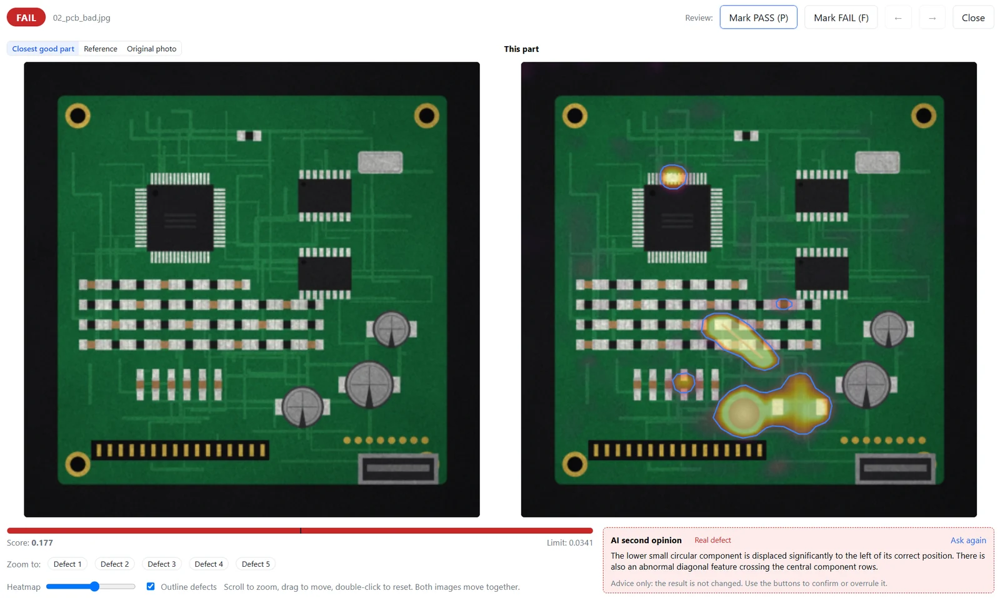

You have a good PCB available, but how many good images do you need before you can try automated inspection? In this VisionInspect example, one good training image was enough to flag the tested defective PCB while accepting the tested good image. Here are the actual results—and how to use them when planning your own starting set.

## The result: one training image, two test images

This test used the owner's own PCB photos. VisionInspect trained on one good image and set the pass/fail limit automatically from good samples only. Training took about two minutes on a laptop GPU with 4 GB of GPU memory.

The test then checked one good image and one defective image. The defective PCB received **FAIL**, with a score of **0.177** against a limit of **0.0341**. The good image was accepted.

| Item | Result |
| --- | --- |
| Good images used for training | 1 |
| Good images tested | 1 |
| Defective images tested | 1 |
| Defective images caught | 1 |
| Defective images missed | 0 |
| Good images rejected | 0 |
| Defective PCB score | 0.177 |
| Automatically set limit | 0.0341 |

The reference appears on the left, with the inspected PCB and heat map on the right. The screen puts the visual comparison, score and verdict together, so the operator can review the flagged areas alongside the decision.

## Was one good sample enough?

**For this board in this check, yes.** One good training image supported a limit that separated the two tested images: the good image passed and the defective image failed. No defective image was needed to set that limit.

That is a useful starting result, but one good test image and one defective test image do not establish a production detection rate or prove that one training image covers every acceptable board variation. The practical takeaway is that a small initial test can be worthwhile—not that every PCB inspection should train on one image.

There are two different questions here. “Can I get a useful first result?” is a question this example answers positively. “What starting set should I prepare for my own inspection?” calls for the product's normal guidance.

## One image in this example; 3 to start normally

VisionInspect's normal starting point is **3 good samples**, with **10–30 recommended**. This PCB example used fewer: one good training image. Keep that distinction clear when planning a trial rather than treating the smallest successful example as the default recipe.

For your own board, start by selecting confirmed good parts. Aim for the recommended 10–30 good samples when preparing the inspection, and include the acceptable appearances you want the system to pass. VisionInspect aligns photos to the reference automatically.

Keep the training set and the check separate in your planning. The training images show the system what good looks like; the test images let you examine its decisions. Record those counts separately, just as they are separated in the table above.

## Where defective samples fit

VisionInspect learns from good parts only. Defective samples are optional and are used to check and fine-tune the pass/fail limit, from 5 bad samples onward—not to teach the model what good looks like.

In this example, the limit came from good samples only. The single defective test image served as a check: its score of 0.177 was above the automatically set limit of 0.0341, so the verdict was FAIL.

Each inspected part gets a heat map, a score and PASS/FAIL against one limit. When reviewing your own trial, examine all three together rather than treating a highlighted image alone as the result.

## Prepare a small, checkable PCB trial

Make the first exercise concrete: gather confirmed good-part photos, identify which images you will use for training, and keep a record of the images you check afterward. Review both sides of the decision—defects flagged and good parts accepted.

For the matching workflow, see [VisionInspect PCB inspection](/pcb-inspection/). Send photos of your good boards to arrange a demo, or run a **1-week trial on your own parts**, starting with 3 good samples and aiming for the recommended 10–30.
