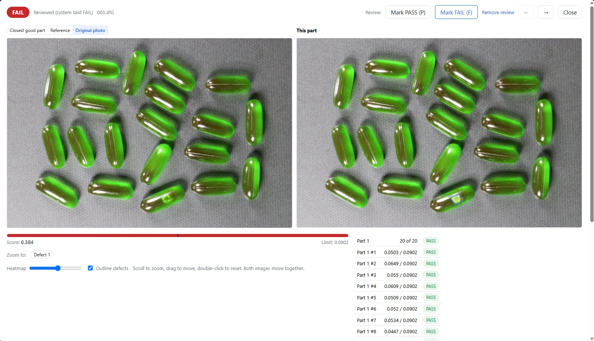

Sie möchten eine Kleinserie automatisch prüfen, haben aber keine Sammlung dokumentierter Fehlerbilder? Dann ist entscheidend, womit Sie den Prüfplatz tatsächlich starten können. Dieses Beispiel mit Kapselbildern zeigt einen Ansatz auf Basis von Gutbildern: Nach dem Training mit 16 Gutbildern wurden drei fehlerhafte Testbilder als n.i.O. erkannt und ein Gutbild als i.O. bewertet.

## Ein überschaubarer Test mit klarem Ergebnis

Die Aufnahmen stammen aus eigenen Fotos des VisionInspect-Inhabers. Sie zeigen grüne Kapseln; im gezeigten Fehlerbild ist eine Kapsel sichtbar beschädigt. VisionInspect bewertete dieses Bild mit **FAIL bei einem Score von 0,384 und einer Grenze von 0,0902**.

Die Grenze wurde automatisch ausschließlich aus Gutbildern bestimmt. Für das Training wurden 16 Gutbilder verwendet; anschließend erfolgte die Prüfung mit einem Gutbild und drei fehlerhaften Bildern.

| Prüfpunkt | Ergebnis dieses Versuchs |
| a | b |
| Gutbilder für das Training | 16 |
| Grundlage der automatisch gesetzten Grenze | Nur Gutbilder |
| Testumfang | 1 Gutbild, 3 fehlerhafte Bilder |
| Erkannte fehlerhafte Bilder | 3 |
| Übersehene fehlerhafte Bilder | 0 |
| Zurückgewiesene Gutbilder | 0 |
| Gezeigtes Fehlerergebnis | FAIL, Score 0,384 bei Grenze 0,0902 |
| Trainingsdauer | Etwa 15 Minuten auf einer Laptop-GPU mit 4 GB Grafikspeicher |

Das ist ein konkreter Funktionsnachweis an vier Testbildern, **kein Nachweis einer Erkennungsrate oder Serienreife**. Für Ihren Prüfplatz zählt deshalb als nächster Schritt der Versuch mit eigenen Teilen und den dort relevanten Abweichungen.

## Was das Fehlerbild zeigt

Der Ergebnisbildschirm stellt die Kapselaufnahmen nebeneinander dar und zeigt die n.i.O.-Entscheidung. Der Score des gezeigten Fehlerbilds liegt über der festgelegten Grenze. Damit wird aus dem Bildvergleich eine eindeutige Prüfentscheidung.

VisionInspect liefert zu jedem Teil eine Heatmap, einen Score und PASS oder FAIL gegen eine Grenze. Für den Werker steht damit nicht nur ein Zahlenwert bereit: Er kann auch die markierte Bildregion ansehen und das Ergebnis am Teil nachvollziehen.

## Warum der Start mit Gutbildern für Kleinserien passt

Wenn Sie noch keine Schlechtteile gesammelt haben, müssen diese nicht erst zur Grundlage des Trainings werden. VisionInspect lernt ausschließlich von Gutteilen. Schlechtteile sind optional und dienen ab fünf Beispielen dazu, die Gut/Schlecht-Grenze zu prüfen und feinzujustieren.

Für den Einstieg sind drei Gutbilder möglich; empfohlen werden zehn bis dreißig. Die 16 Gutbilder dieses Versuchs liegen innerhalb dieser Empfehlung. Die Fotos werden automatisch am Referenzbild ausgerichtet.

Für Ihre Vorbereitung heißt das: Beginnen Sie mit Teilen, die Sie selbst als i.O. freigegeben haben. Halten Sie fest, welche sichtbaren Unterschiede noch zulässig sind und welche zur Zurückweisung führen sollen. Diese Entscheidung gehört zur Prüfaufgabe, nicht allein zur Software.

Den grundsätzlichen Ablauf beschreibt die Lösung zur [KI-Sichtprüfung ohne Fehlerbilder](/de/sichtpruefung-ohne-fehlerbilder/). Das Kapsel-Beispiel zeigt dazu ein konkretes Ergebnis mit einer automatisch aus Gutbildern gesetzten Grenze.

## Training und laufende Prüfung getrennt betrachten

Das Training dauerte hier etwa 15 Minuten auf einer Laptop-GPU mit 4 GB Grafikspeicher. Diese Zeit betrifft das Lernen aus den Gutbildern. Behandeln Sie den Trainingsschritt bei Ihrer Planung getrennt von der späteren Prüfung im Produktionstakt.

Prüfen Sie im eigenen Versuch zunächst, ob die Bewertungen zu Ihren Freigabeentscheidungen passen. Sehen Sie sich dazu Gutbilder und fehlerhafte Bilder samt Score und markierter Region an. Legen Sie vorab fest, wer die Ergebnisse beurteilt und welche Abweichungen für eine n.i.O.-Entscheidung maßgeblich sind.

## Vom Versuch zum Prüfplatz

VisionInspect läuft lokal und offline auf Ihrem PC oder Server. Bilder verlassen den Betrieb nur, wenn Sie die optionale KI-Zweitmeinung einschalten. Diese schreibt einen kurzen Kommentar zu n.i.O.-Teilen, verändert aber nicht das Prüfurteil.

Für die Einbindung stehen Modbus TCP zur SPS sowie Webhook, MQTT und GPIO bereit. CSV- und ZIP-Exporte unterstützen die Übergabe von Ergebnissen. Entscheiden Sie für Ihren Versuch zuerst, ob der Werker das Ergebnis am Bildschirm prüfen soll oder ob eine Weitergabe an die Steuerung zur Prüfaufgabe gehört.

Der sinnvolle Einstieg ist eine klar abgegrenzte Aufgabe: eine Teilefamilie, freigegebene Gutbilder und ausdrücklich benannte Ausschussmerkmale. So prüfen Sie nicht allgemein, ob KI interessant ist, sondern ob die Bewertung zu Ihren konkreten Freigabekriterien passt.

Senden Sie Fotos Ihrer Gutteile für eine Demo oder starten Sie einen **einwöchigen Test mit Ihren eigenen Teilen**. Halten Sie vorhandene Schlechtteile für die Ergebnisprüfung bereit und vergleichen Sie die i.O./n.i.O.-Entscheidungen mit Ihrer bisherigen Sichtprüfung.
