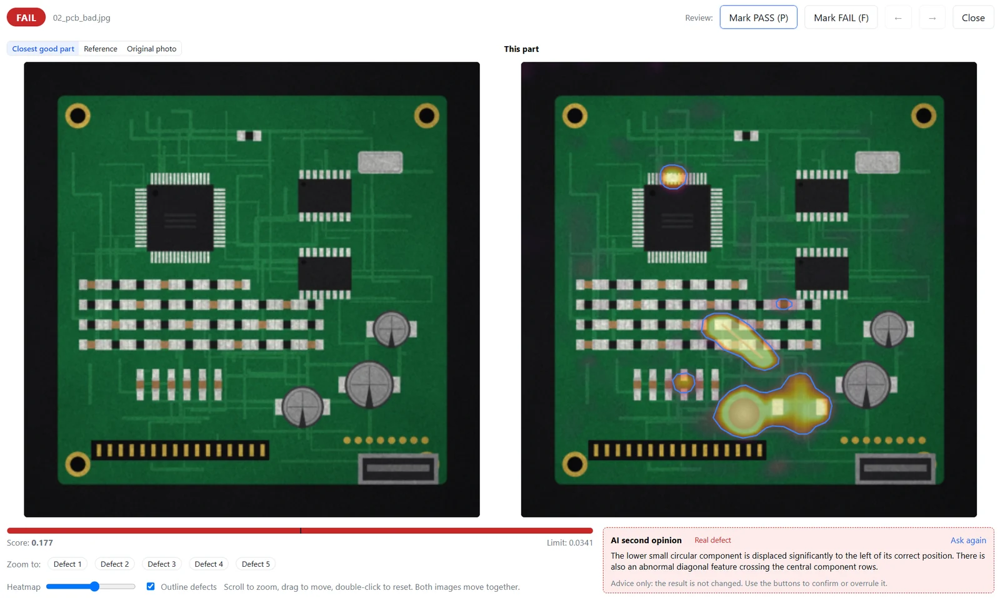

Sie haben eine einwandfreie Leiterplatte zur Hand und möchten die automatische Sichtprüfung ausprobieren. Doch wie viele Gutbilder brauchen Sie dafür? In diesem VisionInspect-Beispiel genügte ein einziges Gutbild zum Einlernen: Die anschließend geprüfte fehlerhafte Leiterplatte wurde erkannt, das geprüfte Gutbild akzeptiert. Hier sehen Sie die Ergebnisse und erfahren, wie Sie Ihren eigenen Start am Prüfplatz vorbereiten.

## Das Ergebnis: ein Trainingsbild, zwei Prüfbilder

Für diesen Versuch kamen eigene Leiterplattenfotos des Betreibers zum Einsatz. VisionInspect lernte anhand eines Gutbilds und legte den Grenzwert für i.O./n.i.O. automatisch ausschließlich aus Gutbildern fest. Das Training dauerte etwa zwei Minuten auf einer Laptop-GPU mit 4 GB Grafikspeicher.

Anschließend wurden ein Gutbild und ein Schlechtbild geprüft. Die fehlerhafte Leiterplatte erhielt **FAIL**, also n.i.O., mit einem Score von **0,177** bei einem Grenzwert von **0,0341**. Das Gutbild wurde als i.O. akzeptiert.

| Prüfgröße | Ergebnis |
| --- | --- |
| Gutbilder zum Einlernen | 1 |
| Geprüfte Gutbilder | 1 |
| Geprüfte Schlechtbilder | 1 |
| Erkannte Schlechtbilder | 1 |
| Übersehene Schlechtbilder | 0 |
| Fälschlich abgelehnte Gutbilder | 0 |
| Score der fehlerhaften Leiterplatte | 0,177 |
| Automatisch gesetzter Grenzwert | 0,0341 |

Links steht die Referenz, rechts die geprüfte Leiterplatte mit Heatmap. Die Ergebnisansicht führt Bildvergleich, Score und Prüfentscheidung zusammen. So kann der Werker die markierten Bereiche direkt neben dem i.O./n.i.O.-Urteil betrachten.

## Hat ein Gutbild gereicht?

**Für diese Leiterplatte in diesem Versuch: ja.** Mit einem Gutbild zum Einlernen entstand ein Grenzwert, der die beiden geprüften Bilder trennte. Das Gutbild bestand die Prüfung, das Schlechtbild fiel durch. Zum Festlegen des Grenzwerts war kein Schlechtbild nötig.

Ein geprüftes Gutbild und ein geprüftes Schlechtbild belegen jedoch weder eine Erkennungsrate für die Produktion noch, dass ein Trainingsbild alle zulässigen Varianten einer Leiterplatte abdeckt. Die praktische Aussage lautet deshalb: Ein kleiner erster Versuch kann sich lohnen. Ein einzelnes erfolgreiches Beispiel ist aber keine allgemeine Vorgabe für die Anzahl der Trainingsbilder.

Für die Planung hilft es, zwei Fragen auseinanderzuhalten. „Kann ich mit wenig Aufwand ein brauchbares erstes Ergebnis erhalten?“ beantwortet dieses Beispiel positiv. Für die Frage „Welche Gutteile soll ich für meinen eigenen Prüfplatz vorbereiten?“ gilt die reguläre Produktempfehlung.

## Hier ein Gutbild, regulär drei zum Start

VisionInspect startet regulär mit **3 Gutteilen**, empfohlen sind **10–30**. Der gezeigte Leiterplattenversuch kam mit weniger aus: einem Gutbild zum Einlernen. Orientieren Sie sich bei Ihrer Planung an der Empfehlung, nicht am kleinsten erfolgreichen Versuch.

Wählen Sie für Ihre eigene Leiterplatte zunächst bestätigte Gutteile aus. Bereiten Sie möglichst die empfohlenen 10–30 Gutteile vor und berücksichtigen Sie dabei die zulässigen Erscheinungsbilder, die Ihre Prüfung akzeptieren soll. VisionInspect richtet die Fotos automatisch an der Referenz aus.

Trennen Sie außerdem Einlernen und anschließende Prüfung in Ihrer Dokumentation. Die Trainingsbilder zeigen dem System, wie ein Gutteil aussieht. Mit den Prüfbildern kontrollieren Sie anschließend die Entscheidungen. Halten Sie beide Bildzahlen getrennt fest, wie in der Tabelle oben.

Damit bleibt auch für die Abstimmung zwischen Qualitätssicherung und Produktion klar, worauf sich ein Ergebnis bezieht. Ein Gutbild zum Einlernen ist etwas anderes als ein Gutbild, das anschließend erfolgreich geprüft wurde. Gerade bei einem kleinen Versuch macht diese Unterscheidung die Ergebnisse nachvollziehbar.

## Welche Rolle spielen Schlechtteile?

VisionInspect lernt ausschließlich anhand von Gutteilen. Schlechtteile sind optional: Ab 5 Schlechtteilen können sie zur Kontrolle und Feinabstimmung des i.O./n.i.O.-Grenzwerts eingesetzt werden. Sie dienen nicht dazu, dem Modell das Aussehen eines Gutteils beizubringen.

In diesem Beispiel wurde der Grenzwert ausschließlich aus Gutbildern bestimmt. Das einzelne Schlechtbild diente danach zur Kontrolle. Sein Score von 0,177 lag über dem automatisch gesetzten Grenzwert von 0,0341; entsprechend lautete das Urteil FAIL beziehungsweise n.i.O.

Jedes geprüfte Teil erhält eine Heatmap, einen Score und eine PASS/FAIL-Entscheidung anhand eines Grenzwerts. Betrachten Sie bei Ihrem eigenen Versuch diese drei Angaben gemeinsam. Die farbige Markierung zeigt die auffälligen Bereiche; Score und Grenzwert machen die zugehörige Prüfentscheidung nachvollziehbar.

## Einen kleinen Leiterplattenversuch vorbereiten

Machen Sie den ersten Versuch überschaubar: Sammeln Sie Fotos bestätigter Gutteile und legen Sie fest, welche Bilder zum Einlernen dienen. Dokumentieren Sie anschließend die geprüften Bilder und deren Ergebnisse. Prüfen Sie dabei beide Seiten der Entscheidung: erkannte Schlechtteile ebenso wie akzeptierte Gutteile.

Den passenden Ablauf finden Sie auf der Seite zur [Leiterplattenprüfung mit VisionInspect](/de/leiterplatten-pruefung/). Senden Sie Fotos Ihrer Gutteile für eine Demo oder starten Sie einen **einwöchigen Test mit Ihren eigenen Teilen**. Planen Sie dafür mindestens 3 Gutteile ein, möglichst die empfohlenen 10–30.
