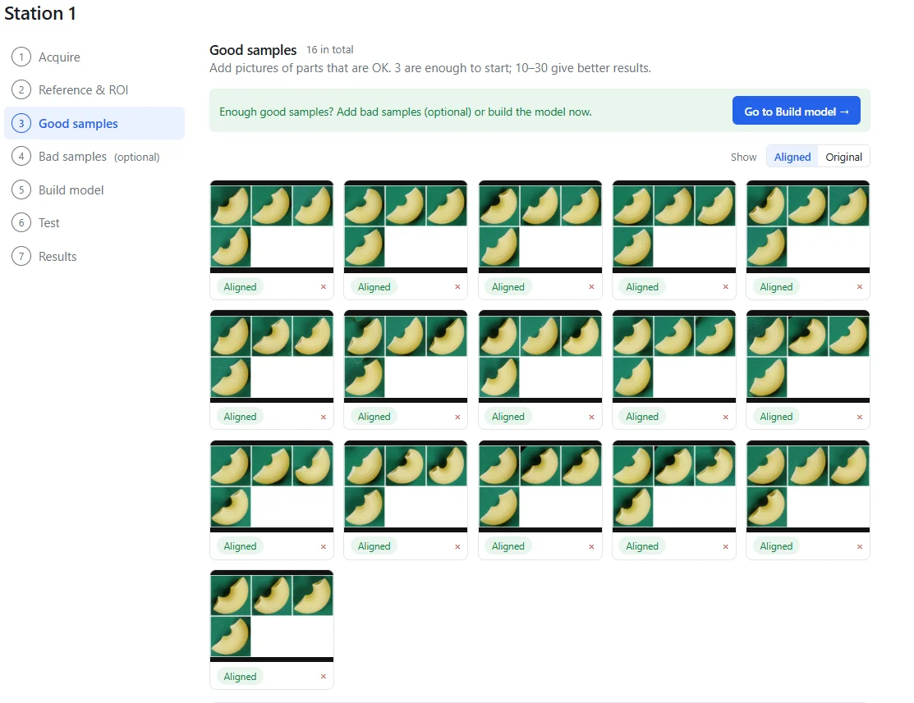

Sie möchten mehrere Teile in einem Kamerabild prüfen, statt jedes Teil einzeln vorzulegen. Doch was sagt ein n.i.O.-Ergebnis dem Werker, und wie zählen Sie die Prüfergebnisse richtig? Dieses Makkaroni-Beispiel zeigt eine Prüfung mit mehreren Teilen im Bild: VisionInspect wurde mit 16 Gutbildern trainiert und erkannte im anschließenden Test alle drei Bilder mit fehlerhaften Teilen.

## Das Ergebnis: mehrere Teile, ein geprüftes Bild

Die Bilder zeigen mehrere Makkaroni auf einem grünen Hintergrund. Beim abgebildeten Prüfergebnis meldet VisionInspect **FAIL**, also **n.i.O.**, mit einem Score von **0,214** bei einem automatisch gesetzten Grenzwert von **0,071**. Die Ergebnisansicht stellt Referenz und Prüfbild nebeneinander und markiert den auffälligen Bereich.

Die gezeigten Ergebnisse stammen aus einem vom VisionInspect-Inhaber durchgeführten Test mit Bildern aus [dem öffentlichen VisA-Datensatz (CC BY 4.0)](https://github.com/amazon-science/spot-diff). Prüfobjekte sind hier Makkaroni, keine Leiterplatten oder Baugruppen aus einer Fertigungslinie.

, Score 0,214 bei automatisch gesetztem Grenzwert 0,071; trainiert mit 16 Gutbildern.")

Entscheidend ist hier: Im Kamerabild lag nicht nur ein einzelnes Teil. Das System kennzeichnete ein Bild mit mehreren Teilen als fehlerhaft. Wenn Sie eine gemeinsame Prüfung mehrerer Teile planen, liefert das einen konkreten Ausgangspunkt für die Bewertung.

## Womit trainiert und was geprüft wurde

VisionInspect lernte anhand von 16 Gutbildern. Auch der i.O./n.i.O.-Grenzwert wurde ausschließlich aus diesen Gutbildern automatisch festgelegt. Die Bilder mit fehlerhaften Teilen dienten anschließend zur Prüfung, nicht zum Erlernen bestimmter Fehlerbilder.

| Prüfpunkt | Ergebnis |
| --- | --- |
| Gutbilder für das Training | 16 |
| Gutbilder im Test | 2 |
| Bilder mit fehlerhaften Teilen im Test | 3 |
| Fehlerhafte Bilder erkannt | 3 |
| Fehlerhafte Bilder übersehen | 0 |
| Gutbilder fälschlich als n.i.O. bewertet | 0 |
| Abgebildetes n.i.O.-Ergebnis | Score 0,214; Grenzwert 0,071 |
| Training | Etwa 20 Minuten auf einer Laptop-GPU mit 4 GB GPU-Speicher |

Dieser kleine Test zeigt, dass das Modell die geprüften Gutbilder und Fehlerbilder getrennt hat. Er belegt keine Erkennungsrate für die Produktion und keine Leistung bei anderen Anordnungen, Fehlerarten oder Aufnahmebedingungen.

## Bilder und einzelne Teile getrennt zählen

Die Testergebnisse beziehen sich auf **Bilder**, nicht auf einzeln gezählte Makkaroni. Das Ergebnis lautet deshalb: „Drei fehlerhafte Bilder erkannt.“ Es bedeutet nicht, dass jedes sichtbare Teil ein eigenes, unabhängig überprüftes Prüfurteil erhalten hat.

Diese Unterscheidung gehört bereits in die Aufgabenbeschreibung für Ihren Prüfplatz. Reicht eine Entscheidung über die gesamte vorgelegte Gruppe? Oder muss der Werker ein bestimmtes Schlechtteil finden und entnehmen können? Halten Sie diese Anforderung vor dem Versuch fest.

Bewerten Sie bei einer Gruppenaufnahme sowohl das Prüfurteil als auch den markierten Bereich. Im gezeigten Beispiel erhält der Werker neben dem Zahlenwert einen Hinweis darauf, wo er nachsehen soll. Prüfen Sie im eigenen Versuch, ob diese Information für den vorgesehenen nächsten Arbeitsschritt ausreicht.

## Die Prüfaufnahme vorbereiten

Die Ansichten zur Einrichtung zeigen die Auswahl des Prüfbereichs und die Gutbilder für das Training. VisionInspect richtet die Fotos automatisch an der Referenz aus. In der Trainingsansicht sind die ausgerichteten Aufnahmen als Vorschaubilder zu sehen.

Legen Sie bei der Vorbereitung fest, welche Teile zum Prüfbild gehören und welche Anordnung noch als zulässig gilt. Bestimmen Sie außerdem, welchen Bereich die Prüfung abdecken soll. Wählen Sie danach Gutbilder aus, die genau diese Prüfaufgabe abbilden.

VisionInspect kann mit 3 Gutbildern starten; empfohlen sind 10–30. In diesem Beispiel wurden 16 Gutbilder verwendet. Diese Anzahl beschreibt den gezeigten Versuch und ist keine allgemeine Mindestvorgabe für Aufnahmen mit mehreren Teilen.

## Den eigenen Versuch auf die Fertigungsaufgabe ausrichten

Trennen Sie für eine aussagekräftige Erprobung die Trainingsbilder von den Testbildern, wie in diesem Beispiel. Prüfen Sie sowohl zulässige Gruppenaufnahmen als auch Aufnahmen mit bekannten Fehlern. Dokumentieren Sie für jedes Testbild das Ergebnis.

Legen Sie die Zähleinheit eindeutig fest: ein Bild, eine Gruppe oder ein einzelnes Teil. Wenn Ihr Prozess einzelne Schlechtteile ausschleusen soll, testen Sie genau diese Anforderung. Ein n.i.O.-Urteil für die gesamte Gruppe beantwortet eine andere Frage als die gezielte Entnahme eines einzelnen Teils.

VisionInspect liefert eine Heatmap, einen Score und ein PASS/FAIL-Urteil, also i.O./n.i.O., anhand eines Grenzwerts. Die Lösung zur [Sichtprüfung ohne Fehlerbilder](/de/sichtpruefung-ohne-fehlerbilder/) erläutert das Lernen mit Gutteilen. Die Prüfung läuft lokal und offline auf Ihrem PC oder Server; nichts verlässt das Werk, solange Sie die optionale KI-Zweitprüfung nicht einschalten.

Senden Sie Fotos von Gutteilen in der Gruppenanordnung, die Sie prüfen möchten, und vorhandene Beispiele mit bekannten Fehlern. Prüfen Sie in einer Demo oder einem einwöchigen Test mit Ihren eigenen Teilen sowohl das Urteil für das Bild als auch den anschließenden Arbeitsschritt des Werkers.
