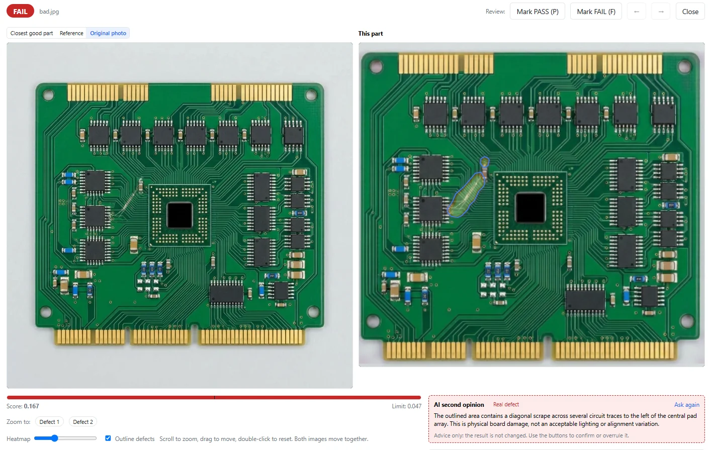

You want to inspect PCBs automatically, but you do not have a collection of defect images for training. In this VisionInspect test, a single good board was enough to learn from: the system then inspected 12 good boards and 11 defective boards. It caught all 11 defective boards and rejected none of the good boards. The example shown here is a scratch across the traces next to the BGA chip.

## The test: learning from one good board

For this test, VisionInspect was trained on one good PCB. The pass/fail limit was set automatically using only the good sample. Defective boards were used neither for training nor for setting that limit.

Training took about 4 minutes on a laptop GPU with 4 GB of GPU memory. The system then inspected the 12 good and 11 defective boards. The photos are VisionInspect’s own, and the results were prepared by the owner.

| Test detail | Result in this test |
|---|---|
| Training sample | 1 good PCB |
| Pass/fail limit | Set automatically from the good sample only |
| Training time | About 4 minutes |
| Training hardware | Laptop GPU with 4 GB of GPU memory |
| Good boards tested | 12, with 0 rejected |
| Defective boards tested | 11, with 11 caught and 0 missed |

For this board, one good training sample was enough. This test does not establish a general detection rate or guarantee that one good sample will be enough for other PCBs.

## The defect: a scratch next to the BGA chip

The board shown has a scratch across the traces next to the BGA chip. VisionInspect assigned it a score of **0.167** against an automatically set limit of **0.047**. The result was therefore **FAIL**.

The highlighted area tells the inspector where to take a closer look. The score and limit also make the reason for the rejection clear. Rather than just displaying a red status, the result identifies a location and shows the decision against a defined limit.

The two defect views show the same board: one is the plain board view, the other is the VisionInspect result screen. They document one finding from the test, not two separate defective boards.

## Why no defect images were needed

VisionInspect learns what good parts look like. Each inspected part receives a heat map, a score and a PASS/FAIL decision against one limit. The app proposes that limit and automatically aligns photos to the reference.

Bad samples are optional. With at least 5 bad samples, they can be used to check and fine-tune the limit; they are not needed for learning. In this test, the limit remained based solely on the good sample, while the 11 defective boards were used for the subsequent test.

For a production inspection station, that distinction matters: **training samples define the good condition; test samples check the decision.** If you have only good parts to begin with, you can start without first building a defect-image library. Read more about the approach on our [visual inspection without defect images](/visual-inspection-without-defect-images/) page.

## One board in this test, more good samples to start

The single training board is the notable feature of this result. For a standard setup, VisionInspect starts with 3 good samples and recommends 10–30. Use that guidance when preparing your own inspection trial.

Choose parts that you would actually approve as good. Then test additional good parts to check whether the proposed limit fits your inspection task. If defective parts are available, include them in the test and record their results separately.

Keep the review practical: which known defects were caught, which were missed, and which good parts were rejected? Recording those outcomes separately makes the test useful for a quality decision. Here, the outcome was 11 defective boards caught, 0 missed and 0 good boards rejected.

## What to test at your own inspection station

Start with a clearly defined inspection task and accepted good samples of your PCB. Test the proposed limit on additional parts and review the highlighted areas. Record the results for good boards as well as failed inspections, so your review covers both missed defects and rejected good parts.

VisionInspect runs locally and offline on your PC or server. Nothing leaves the plant unless you turn on the optional AI second opinion. If enabled, it provides a short advisory comment on failed parts; it does not change the PASS/FAIL verdict.

Want to check whether this works for your PCB? Send photos of good parts for a demo, or arrange a **1-week trial with your own parts**. Start with your inspection task—not a collection of defect images.
