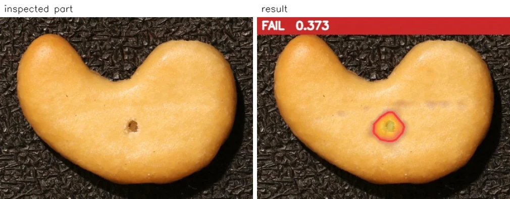
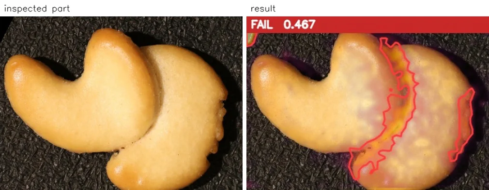
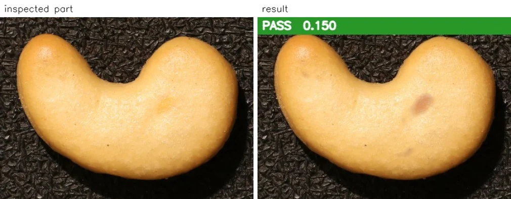
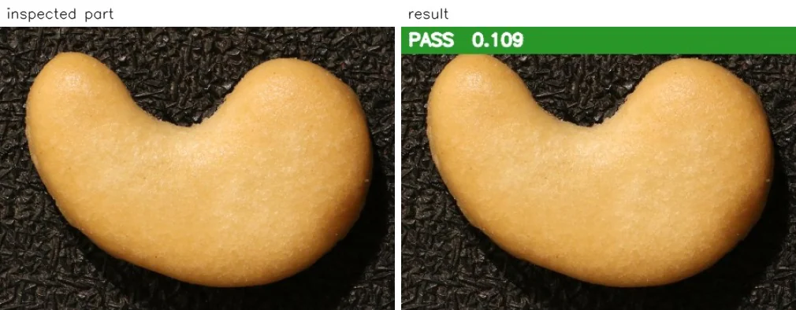

Ihr Prüfplatz soll Schlechtteile aussortieren, nicht einwandfreie Ware in den Ausschuss schicken. Doch wenn kein Gutteil fälschlich aussortiert wird, ist damit erst eine Seite der Prüfung bewertet. Dieser VisionInspect-Benchmark zeigt beide Seiten: Alle geprüften Gutteile wurden angenommen, einige Schlechtteile allerdings ebenfalls.

## Keine Pseudofehler – aber auch nicht jeden Fehler erkannt

Für den Benchmark wurden Cashew-Bilder aus [dem öffentlichen VisA-Datensatz (CC BY 4.0)](https://github.com/amazon-science/spot-diff) verwendet. VisionInspect lernte anhand von 12 Gutteilen und schlug ausschließlich auf dieser Grundlage automatisch einen Grenzwert für die i.O./n.i.O.-Entscheidung vor. Zum Festlegen des Grenzwerts wurden keine Schlechtteile verwendet; die Fotos wurden automatisch am Referenzbild ausgerichtet.

Anschließend wurden 12 Gutteile und 12 Schlechtteile geprüft. Beim vorgeschlagenen Grenzwert erkannte VisionInspect 9 Schlechtteile und sortierte kein Gutteil fälschlich aus. Damit passierten 3 Schlechtteile die Prüfung als i.O.

| Prüfpunkt | Ergebnis |
|---|---:|
| Gutteile zum Einlernen des Modells | 12 |
| Schlechtteile zum Festlegen des Grenzwerts | 0 |
| Geprüfte Gutteile | 12 |
| Geprüfte Schlechtteile | 12 |
| Erkannte Schlechtteile beim vorgeschlagenen Grenzwert | 9 |
| Fälschlich aussortierte Gutteile | 0 |
| Erkannte Schlechtteile bei niedrigerem Grenzwert, weiterhin ohne Gutteile auszusortieren | 9 |

Dieser kleine Benchmark zeigt die Ergebnisse für diese Testbilder. Er belegt keine Erkennungsrate für die Produktion und garantiert keinen Betrieb ohne Pseudofehler an Ihrer Linie.

## Erkannte und übersehene Fehler gemeinsam ansehen

Jedes geprüfte Teil erhält eine Heatmap, einen Score und eine Entscheidung anhand eines einzigen Grenzwerts. Die Ergebnisanzeige verwendet dafür PASS und FAIL, entsprechend i.O. und n.i.O. Im folgenden Beispiel wurde das Schlechtteil mit **FAIL 0,373** erkannt; die Heatmap ergänzt den Zahlenwert um eine bildliche Darstellung zur Prüfung.

Ein weiteres erkanntes Schlechtteil erhielt **FAIL 0,467**. Beide Beispiele gehören in die Bewertung des Prüfplatzes. Sie sollten aber nicht die einzigen Bilder sein, die Sie bei der Entscheidung über den Einsatz betrachten.

Genauso wichtig ist das übersehene Schlechtteil. Obwohl es fehlerhaft war, lautete das Ergebnis **PASS 0,150**. Die grüne Anzeige dokumentiert die Entscheidung des Systems – in diesem Fall wurde ein Schlechtteil als i.O. durchgelassen.

Zum Vergleich erhielt das folgende Gutteil **PASS 0,109**. Behalten Sie beide Fälle in der Auswertung: das korrekt angenommene Gutteil und das fälschlich angenommene Schlechtteil. Wer nur die n.i.O.-Bilder betrachtet, lässt den übersehenen Fehler aus der Bewertung heraus.

## Ein niedrigerer Grenzwert löste den Zielkonflikt nicht

Im Benchmark wurde auch ein niedrigerer Grenzwert geprüft. Dabei galt eine klare Bedingung: Weiterhin durfte kein Gutteil fälschlich aussortiert werden. Unter dieser Bedingung blieb die Zahl der erkannten Schlechtteile bei **9**; es kam kein zusätzlich erkanntes Schlechtteil hinzu.

Das ist das zentrale Ergebnis für die Praxis. Der vorgeschlagene Grenzwert ließ alle geprüften Gutteile passieren. Ihn strenger einzustellen brachte jedoch keine zusätzlichen Treffer, solange weiterhin alle Gutteile angenommen werden mussten.

Trennen Sie deshalb bei der Bewertung zwei Fragen: „Wie viele Gutteile haben wir fälschlich aussortiert?“ und „Wie viele Schlechtteile haben wir durchgelassen?“ Geben Sie eine Änderung nicht allein deshalb frei, weil eine dieser Zahlen besser aussieht. Prüfen Sie beide Ergebnisse erneut an denselben Testteilen.

## Was Sie an Ihren eigenen Teilen prüfen sollten

Legen Sie zuerst fest, was in Ihrem Betrieb als Gutteil gilt. Nehmen Sie beim Zusammenstellen der Bilder auch zulässige Unterschiede im Erscheinungsbild auf, statt nur besonders gleichmäßige Teile auszuwählen. Kennzeichnen Sie die Gut- und Schlechtteile für den Test eindeutig, damit Sie jede Systementscheidung mit dem bekannten Teilezustand abgleichen können.

VisionInspect lernt ausschließlich von Gutteilen. Der Einstieg ist mit 3 Gutteilen möglich, empfohlen werden 10–30; in diesem Benchmark waren es 12. Schlechtteile sind optional und können ab 5 Beispielen dazu dienen, den Grenzwert zu prüfen und feinzujustieren – nicht dazu, dem Modell das Aussehen eines Gutteils beizubringen.

Erfassen Sie beim Prüfen eines vorgeschlagenen Grenzwerts sowohl fälschlich aussortierte Gutteile als auch übersehene Schlechtteile. Sehen Sie sich die Bilder hinter diesen Ergebnissen an, nicht nur die Summen. Wenn Sie den Grenzwert ändern, vergleichen Sie beide Ergebnisse erneut, bevor Sie die Einstellung übernehmen.

Auf der Lösungsseite zur [Sichtprüfung ohne Fehlerbilder](/de/sichtpruefung-ohne-fehlerbilder/) erfahren Sie mehr über das Lernen anhand von Gutteilen. Für Ihren Prüfplatz zählt, ob das Verhältnis zwischen angenommenen Gutteilen und erkannten Schlechtteilen Ihre Prüfanforderungen erfüllt.

Senden Sie Fotos Ihrer Gutteile für eine Demo oder einen **einwöchigen Test mit Ihren eigenen Teilen**. Wenn Sie bekannte Schlechtteile haben, nehmen Sie diese zur Grenzwertprüfung dazu – und lassen Sie sich neben den erkannten auch die übersehenen Fehler zeigen.
