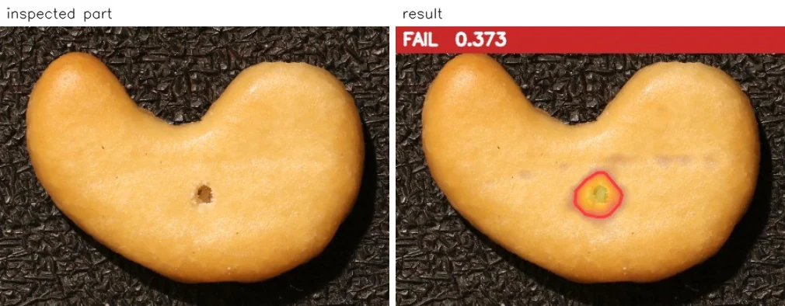
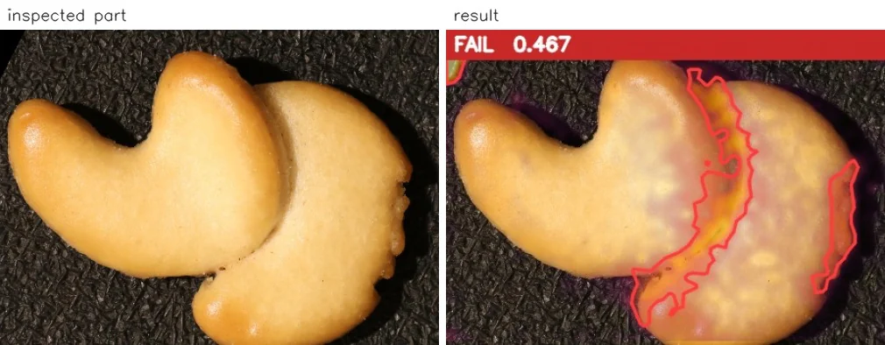
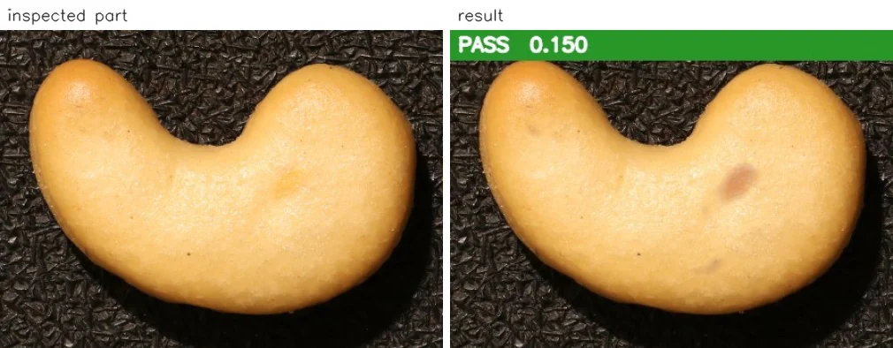
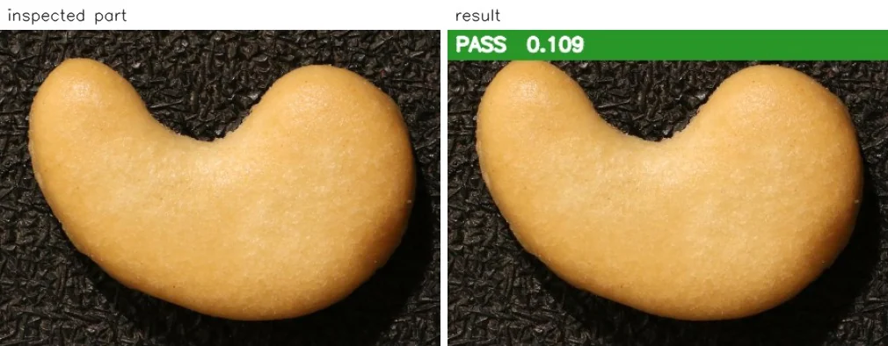

You want the inspection station to stop bad parts, not send good production to the reject bin. But a clean reject record is only half the story. This VisionInspect benchmark shows both sides: no good test parts were wrongly rejected, while some bad parts still passed.

## No false rejects—and not every defect caught

The benchmark used cashew images from [the public VisA dataset (CC BY 4.0)](https://github.com/amazon-science/spot-diff). VisionInspect built the model from 12 good samples and automatically proposed the pass/fail limit from those good samples alone. No bad samples were used to set the limit, and photos were aligned to the reference automatically.

The test then checked 12 good parts and 12 bad parts. At the proposed limit, VisionInspect rejected 9 bad parts and wrongly rejected no good parts. That left 3 bad parts passing inspection.

| Benchmark item | Result |
|---|---:|
| Good samples used to build the model | 12 |
| Bad samples used to set the limit | 0 |
| Good parts tested | 12 |
| Bad parts tested | 12 |
| Bad parts caught at the proposed limit | 9 |
| Good parts wrongly rejected | 0 |
| Bad parts caught with a lower limit while still rejecting no good parts | 9 |

This small benchmark shows what happened on these test images; it does not establish a production detection rate or guarantee zero false rejects on your line.

## Read the caught defects alongside the misses

Each inspected part gets a heat map, a score and a PASS/FAIL verdict against one limit. In the example below, the defective part was caught with a result of **FAIL 0.373**. The heat map provides a visual result for review alongside the numerical score.

Another caught defect received **FAIL 0.467**. These are useful examples to review, but they should not be the only images on the screen when deciding whether an inspection setup is suitable.

The missed example is just as important. It was a bad part, yet the result panel read **PASS 0.150**. A green verdict records the system’s decision; here, that decision let a defective part through.

For comparison, the good part below received **PASS 0.109**. Keep both examples in the review: the correctly accepted good part and the incorrectly accepted bad part. Looking only at rejected images would leave the missed defect out of the discussion.

## A lower limit did not solve this trade-off

The benchmark also checked a lower limit under a specific condition: no good test part could be rejected. Under that condition, the number of bad parts caught remained **9**. Lowering the limit did not recover an additional bad part while preserving zero false rejects.

That is the practical finding at the centre of this result. The proposed limit accepted every good test part, but simply making it stricter offered no additional catches within the same no-false-reject constraint.

For a production review, keep the two questions separate: “How many good parts did we reject?” and “How many bad parts did we pass?” Do not approve a change because one answer looks better without checking the other against the same test parts.

## What to check on your own parts

Start by defining what your team accepts as a good part. When collecting examples, include acceptable appearance differences rather than selecting only the most uniform-looking pieces. Keep good and bad test parts identified so you can check the verdict against the part’s known status.

VisionInspect learns from good parts only. It can start with 3 good samples, with 10–30 recommended; this benchmark used 12. Bad samples are optional and, from 5 bad samples onward, can be used to check and fine-tune the pass/fail limit rather than teach the model what a good part looks like.

When reviewing a proposed limit, record both wrongly rejected good parts and missed bad parts. Review the images behind those outcomes, not just the totals. If you try a different limit, compare both outcomes again before accepting the change.

The [visual inspection without defect images solution](/visual-inspection-without-defect-images/) explains this good-parts-only approach. The relevant question for your line is whether the balance between accepted good parts and caught defects meets your inspection requirements.

Send photos of your good parts to arrange a demo or a **1-week trial on your own parts**. If you have known bad parts, include them for the limit review—and ask to see the misses alongside the catches.
