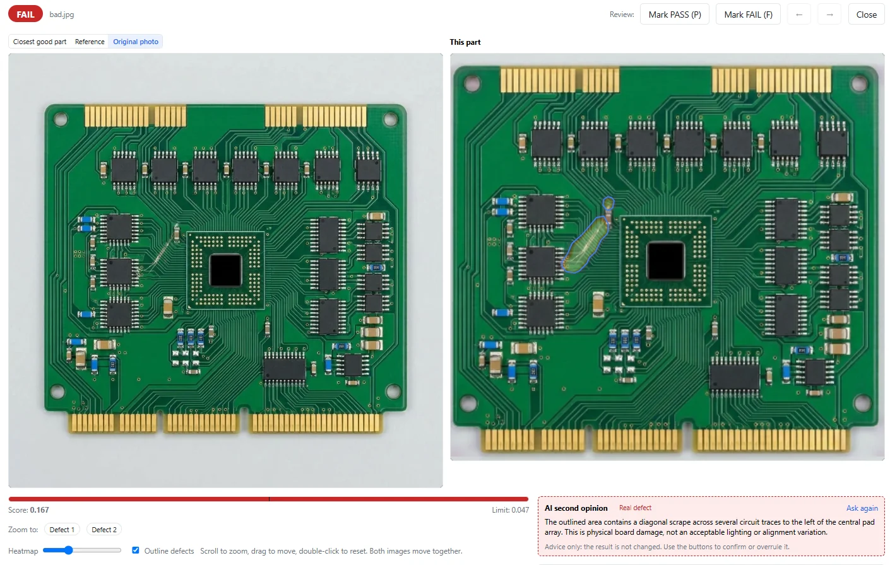

Sie möchten Leiterplatten automatisch prüfen, haben aber keine Sammlung von Fehlerbildern zum Trainieren? In diesem VisionInspect-Versuch reichte eine einzige Gutplatine als Lernvorlage: Anschließend wurden 12 Gutplatinen und 11 fehlerhafte Platinen geprüft. Alle 11 Schlechtteile wurden erkannt, keine Gutplatine wurde abgewiesen. Der gezeigte Fund ist ein Kratzer quer über die Leiterbahnen neben dem BGA-Chip.

## Der Versuch: Lernen mit einer Gutplatine

Für diesen Versuch wurde VisionInspect mit einer guten Leiterplatte trainiert. Die Prüfgrenze wurde automatisch und ausschließlich aus den Gutmustern festgelegt. Schlechtteile wurden also weder zum Lernen noch zum Einstellen dieser Grenze verwendet.

Das Training dauerte ungefähr 4 Minuten auf einer Laptop-GPU mit 4 GB Grafikspeicher. Danach folgte die Prüfung der 12 guten und 11 fehlerhaften Leiterplatten. Die Aufnahmen stammen aus eigenen Fotos von VisionInspect; auch die Ergebnisse wurden von VisionInspect aufbereitet.

| Prüfpunkt | Ergebnis dieses Versuchs |
|---|---|
| Lernvorlage | 1 Gutplatine |
| Festlegung der Prüfgrenze | Automatisch, nur anhand der Gutmuster |
| Trainingsdauer | Etwa 4 Minuten |
| Hardware für das Training | Laptop-GPU mit 4 GB Grafikspeicher |
| Geprüfte Gutplatinen | 12, davon 0 abgewiesen |
| Geprüfte Schlechtplatinen | 11, davon 11 erkannt und 0 übersehen |

Für diese Leiterplatte war eine Gutvorlage ausreichend. Der Versuch belegt aber keine allgemeine Erkennungsrate und garantiert nicht, dass eine Gutvorlage bei anderen Leiterplatten genügt.

## Der konkrete Fund: Kratzer neben dem BGA-Chip

Die gezeigte Leiterplatte hat einen Kratzer quer über die Leiterbahnen neben dem BGA-Chip. VisionInspect bewertete sie mit einem Score von **0,167**. Die automatisch gesetzte Prüfgrenze lag bei **0,047**; das Ergebnis lautete deshalb **FAIL beziehungsweise n.i.O.**

Die Markierung zeigt dem Prüfer, welchen Bereich er näher ansehen sollte. Der Score und die Prüfgrenze machen zugleich nachvollziehbar, warum die Platine als n.i.O. eingestuft wurde. Damit besteht das Ergebnis nicht nur aus einem roten Status, sondern aus einer örtlichen Markierung und einer Entscheidung gegen eine festgelegte Grenze.

Die beiden verfügbaren Fehleraufnahmen zeigen dieselbe Leiterplatte: einmal die Bauteilansicht und einmal die VisionInspect-Ergebnisansicht. Es handelt sich also um einen gezeigten Fund aus dem Versuch, nicht um zwei unterschiedliche erkannte Schlechtteile.

## Warum dafür keine Fehlerbilder nötig waren

VisionInspect lernt das Aussehen guter Teile. Für die Prüfung erhält jedes Teil eine Heatmap, einen Score und eine i.O./n.i.O.-Entscheidung gegen eine gemeinsame Prüfgrenze. Die App schlägt diese Grenze vor und richtet die Fotos automatisch zur Referenz aus.

Schlechtmuster sind optional. Ab 5 Schlechtmustern können sie dazu dienen, die Grenze zu überprüfen und fein einzustellen; sie sind keine Voraussetzung für das Lernen. In diesem Versuch blieb die Grenze ausschließlich gutteilbasiert, während die 11 Schlechtplatinen zum anschließenden Test gehörten.

Für Ihren Prüfplatz ist diese Trennung wichtig: **Lernvorlagen beschreiben den guten Zustand, Prüfmuster kontrollieren die Entscheidung.** Wer zunächst nur Gutteile hat, kann damit beginnen, statt erst eine Fehlersammlung für das Training aufzubauen. Weitere Informationen zum Verfahren finden Sie unter [Sichtprüfung ohne Fehlerbilder](/de/sichtpruefung-ohne-fehlerbilder/).

## Eine Gutplatine im Versuch, mehr Gutteile für den Start

Der besondere Punkt dieses Ergebnisses ist die einzelne Lernvorlage. Sie sollten diese Zahl trotzdem nicht als Vorgabe für Ihren Prüfplatz übernehmen: VisionInspect sieht regulär 3 Gutmuster zum Start vor und empfiehlt 10–30 Gutmuster.

Wählen Sie dafür Teile aus, die Sie tatsächlich als i.O. freigeben würden. Prüfen Sie anschließend mit weiteren Gutteilen, ob die vorgeschlagene Grenze zu Ihrer Aufgabe passt. Falls Schlechtteile vorhanden sind, nehmen Sie diese ebenfalls in den Test auf und halten Sie die Ergebnisse getrennt fest.

So bleibt die Bewertung praktisch: Welche bekannten Fehler wurden erkannt? Welche wurden übersehen? Welche guten Teile wurden abgewiesen? Genau diese getrennte Betrachtung macht den vorliegenden Versuch aussagekräftig: 11 erkannte Schlechtplatinen stehen 0 übersehenen Fehlerteilen und 0 abgewiesenen Gutplatinen gegenüber.

## Was Sie am eigenen Prüfplatz testen sollten

Beginnen Sie mit einer klaren Prüfaufgabe und akzeptierten Gutmustern Ihrer Leiterplatte. Lassen Sie die vorgeschlagene Grenze zunächst gegen weitere Teile laufen und kontrollieren Sie die markierten Stellen. Dokumentieren Sie dabei nicht nur n.i.O.-Entscheidungen, sondern auch die Ergebnisse der Gutteile.

VisionInspect läuft lokal und offline auf Ihrem PC oder Server. Solange die optionale KI-Zweitmeinung ausgeschaltet bleibt, verlässt nichts das Werk. Falls Sie diese einschalten, liefert sie einen kurzen Kommentar zu fehlgeschlagenen Prüfungen; die i.O./n.i.O.-Entscheidung verändert sie nicht.

Sie möchten prüfen, ob das mit Ihrer Leiterplatte funktioniert? Senden Sie Fotos von Gutteilen für eine Demo oder vereinbaren Sie einen **1-wöchigen Test mit Ihren eigenen Teilen**. Ausgangspunkt ist Ihre Prüfaufgabe – nicht eine vorab aufgebaute Sammlung von Fehlerbildern.
